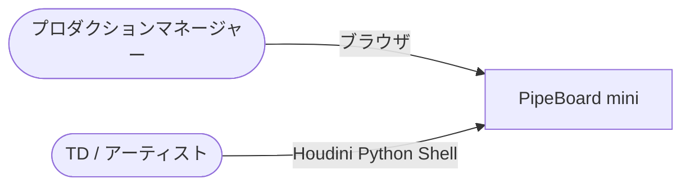
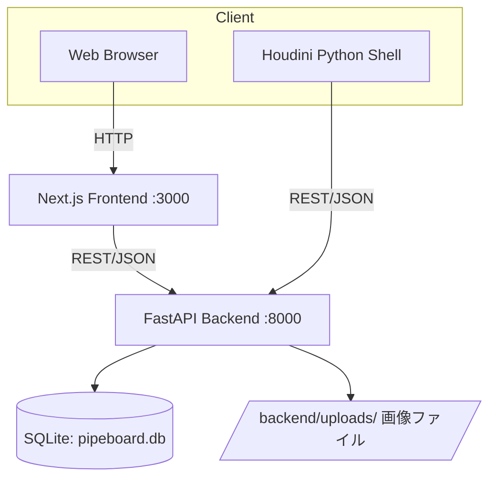
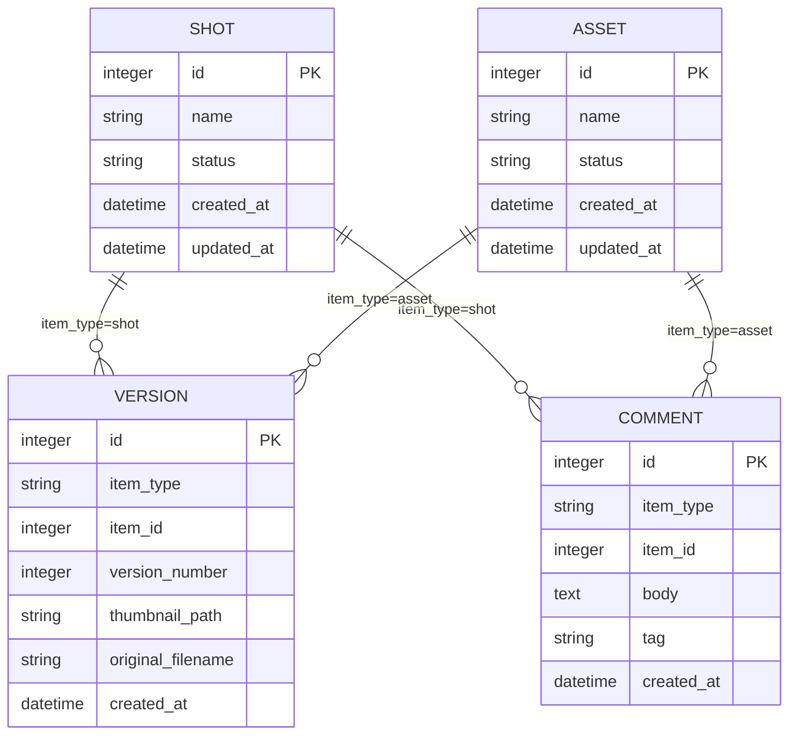

# 仕様書: PipeBoard mini

| 項目 | 値 |
|------|---|
| 版 | 0.1 |
| 作成日 | 2026-09-07 |
| 最終更新 | 2026-09-07 |
| ステータス | ドラフト |
| 著者 | 金子直樹 |
| 関連 | [要件定義書](./要件定義書.md) ／ 姉妹プロジェクト [PipeInit 仕様書 v2](../../pipeinit/docs/仕様書_v2.md) |

> **本書の位置づけ**: 要件定義書で決めた「WHAT/WHY」を、実装可能な「HOW」に落とし込む。3プロジェクト中唯一のWeb+REST APIプロジェクトであるため、data-design（§4）・api-spec（§5）・screen-spec（§6）・feature-spec（§7）を特に厚く記述し、認証・決済・SRE関連（§9の一部・§11.4等）は要件定義書の判断（該当なし）を継承して簡略化する。

---

## 1. quick-reference

| 項目 | 値 |
|------|---|
| リポジトリ | `~/dev/pipeboard`（公開後 `github.com/<user>/pipeboard`） |
| フロントエンド起動 | `cd frontend && npm install && npm run dev`（http://localhost:3000） |
| バックエンド起動 | `cd backend && pip install -r requirements.txt && uvicorn app.main:app --reload`（http://localhost:8000） |
| 一括起動 | `docker-compose up`（frontend:3000 / backend:8000） |
| API仕様確認 | http://localhost:8000/docs（FastAPI自動生成Swagger UI） |
| フロントテスト | `cd frontend && npm run test`（Vitest）／ `npm run test:e2e`（Playwright） |
| バックテスト | `cd backend && pytest --cov=app -v` |
| Lint一括 | フロント: `npm run lint`／バック: `ruff check . && ruff format --check .` |
| CI | `.github/workflows/ci.yml`（frontend/backend別ジョブ、push/PR時に自動実行、§11.2） |
| Houdini連携確認 | `python scripts/houdini_status_update.py --shot-id 1 --status in_review` |
| デモ用DBリセット | `rm backend/pipeboard.db && python backend/app/seed.py` |

---

## 2. overview-and-architecture

### 2.1 C4 Context



外部システム連携なし（要件定義書§4.3の判断を継承）。

### 2.2 C4 Container



### 2.3 同期/非同期の境界

全操作を同期REST APIで完結させる。非同期キュー・バッチ処理は導入しない（要件定義書§11「該当なし」の判断を継承）。

### 2.4 データフロー

- **書き込みの主経路**: フロントエンド or Houdiniスクリプト → FastAPI → SQLAlchemy → SQLite
- **読み取りの主経路**: フロントエンド（カンバン初期表示） → FastAPI（GET /shots, /assets） → SQLite

### 2.5 外部システム

なし。

### 2.6 ADR索引

| ADR | タイトル | ステータス |
|---|---|---|
| ADR-0001 | モノリポ・モジュラー構成の採用 | Accepted |
| ADR-0002 | VERSION/COMMENTのポリモーフィック関連採用 | Accepted |
| ADR-0003 | SQLiteをv1の正本DBとして採用 | Accepted |
| ADR-0004 | 認証・権限管理をv1スコープ外とする設計判断 | Accepted（本文§14.4） |

### 2.7 障害時の縮退

本番運用を想定しないため、DB障害時の縮退モード（キャッシュ応答等）は設計しない。API接続不可時、フロントエンドはエラートーストを表示し操作を無効化する（フェイルセーフのUI挙動のみ実装）。

### 2.8 将来の拡張余地

認証導入（ADR-0004）、PostgreSQL移行（ADR-0003）、楽観ロックによる同時編集対応（要件定義書§16.6 Q2）を将来拡張の候補として本書のADR/annexに設計案を残す。

---

## 3. tech-stack-and-repo

### 3.1 技術スタック確定表

要件定義書§4.4を正本とし、実装時の確定バージョンは以下の通り（`my-web`/`tonihaya-calendar`の実測値に準拠）。

| カテゴリ | 採用 | バージョン |
|---|---|---|
| フロントエンド | Next.js (App Router) | ^15.5.20 |
| 言語（フロント） | TypeScript | ^5.6.0 |
| UI | React | ^19.2.7 |
| スタイリング | Tailwind CSS | ^4.3.2 |
| フロントテスト | Vitest / @testing-library/react / happy-dom | ^3.0 / ^16.3.2 / ^20.10.6 |
| E2E | Playwright | 最新 |
| バックエンド | FastAPI | ^0.115.0 |
| ASGIサーバー | uvicorn | ^0.32.0 |
| ORM | SQLAlchemy | ^2.0.36 |
| バリデーション | Pydantic | ^2.9.0（FastAPI同梱） |
| バックテスト | pytest / httpx / pytest-cov | ^8.3 / ^0.27 / ^5.0 |
| Lint（バック） | ruff | ^0.7.0 |
| DB | SQLite | 3.4x（Python標準`sqlite3`） |
| コンテナ | Docker / docker-compose | 最新 |

### 3.2 ディレクトリ構成

```
pipeboard/
├── frontend/                       # Next.js（my-web/tonihaya-calendarの構成を踏襲）
│   ├── src/
│   │   ├── app/
│   │   │   ├── page.tsx            # カンバンボード（SCR-001）
│   │   │   └── shots/[id]/page.tsx # ショット詳細（SCR-002）
│   │   ├── components/
│   │   │   ├── kanban/             # KanbanBoard, KanbanColumn, KanbanCard
│   │   │   ├── gallery/            # VersionGallery, VersionModal
│   │   │   └── comments/           # CommentList, CommentForm
│   │   ├── domain/                 # tonihaya-calendarのdomain分離パターンを踏襲
│   │   │   ├── shot/
│   │   │   └── status/             # ステータス遷移ルールの純粋関数
│   │   └── lib/
│   │       └── api-client.ts       # fetchラッパー
│   ├── e2e/
│   │   └── kanban.spec.ts          # my-webのe2e構成を踏襲
│   ├── package.json
│   └── vitest.config.ts
├── backend/
│   ├── app/
│   │   ├── main.py                 # FastAPIエントリポイント
│   │   ├── models.py               # SQLAlchemyモデル
│   │   ├── schemas.py              # Pydanticスキーマ
│   │   ├── database.py             # DB接続・セッション管理
│   │   ├── seed.py                 # デモデータ投入スクリプト
│   │   └── routers/
│   │       ├── shots.py
│   │       ├── assets.py
│   │       ├── versions.py
│   │       └── comments.py
│   ├── tests/
│   │   ├── conftest.py
│   │   ├── test_shots.py
│   │   ├── test_versions.py
│   │   └── test_comments.py
│   ├── uploads/                     # アップロード画像（.gitignore対象）
│   └── requirements.txt
├── scripts/
│   └── houdini_status_update.py     # Houdini Python Shellから実行
├── docs/
│   ├── 要件定義書.md
│   ├── 仕様書.md
│   └── adr/
├── .github/workflows/
│   ├── ci-frontend.yml
│   └── ci-backend.yml
├── docker-compose.yml
├── README.md
└── LICENSE
```

### 3.3 環境・ランタイム

- Node.js 22以上（`tonihaya-calendar`の`.nvmrc`実績に合わせる）
- Python 3.11以上
- パッケージマネージャ: フロントは npm（両案件で使用実績あり）、バックは pip + `requirements.txt`（個人開発規模のためpoetry/uv導入は見送り、シンプルさを優先）

### 3.4 環境一覧

| 環境 | frontend URL | backend URL | DB |
|---|---|---|---|
| local | http://localhost:3000 | http://localhost:8000 | `backend/pipeboard.db` |
| CI | - | - | テスト用一時SQLite（`:memory:`または一時ファイル） |
| demo（任意） | Vercel | Render/Fly.io | デモ専用SQLiteファイル |

### 3.5 主要コマンド一覧

```bash
# 初回セットアップ
cd backend && pip install -r requirements.txt && python app/seed.py
cd frontend && npm install

# 開発起動（2ターミナル、またはdocker-compose up）
cd backend && uvicorn app.main:app --reload --port 8000
cd frontend && npm run dev

# テスト
cd backend && pytest --cov=app --cov-report=term-missing
cd frontend && npm run test && npm run test:e2e
```

---

## 4. data-design

### 4.1 ER図



### 4.2 データ辞書

**shots**

| 列 | 型 | NOT NULL | 既定値 | 説明 |
|---|---|---|---|---|
| id | INTEGER | ◯ (PK, AUTOINCREMENT) | - | 主キー |
| name | VARCHAR(100) | ◯ | - | ショット名 |
| status | VARCHAR(20) | ◯ | `'not_started'` | enum: not_started/in_progress/in_review/done |
| created_at | DATETIME | ◯ | `CURRENT_TIMESTAMP` | 作成日時 |
| updated_at | DATETIME | ◯ | `CURRENT_TIMESTAMP` | 更新日時（更新の都度アプリ層で上書き） |

**assets** は`shots`と同一スキーマ（別テーブルとして分離、理由はADR-0002）。

**versions**

| 列 | 型 | NOT NULL | 既定値 | 説明 |
|---|---|---|---|---|
| id | INTEGER | ◯ (PK) | - | 主キー |
| item_type | VARCHAR(10) | ◯ | - | `'shot'` \| `'asset'` |
| item_id | INTEGER | ◯ | - | shots.id または assets.id（アプリ層でFK相当の整合性チェック、DB制約としてのFKは張らない。理由は§4.6） |
| version_number | INTEGER | ◯ | - | 同一item_type+item_idでの連番 |
| thumbnail_path | VARCHAR(255) | ◯ | - | `uploads/<uuid>.<ext>` 形式の相対パス |
| original_filename | VARCHAR(255) | - | NULL | 表示用の元ファイル名（パスとしては使用しない） |
| created_at | DATETIME | ◯ | `CURRENT_TIMESTAMP` | アップロード日時 |

**comments**

| 列 | 型 | NOT NULL | 既定値 | 説明 |
|---|---|---|---|---|
| id | INTEGER | ◯ (PK) | - | 主キー |
| item_type | VARCHAR(10) | ◯ | - | `'shot'` \| `'asset'` |
| item_id | INTEGER | ◯ | - | 対象レコードのID |
| body | TEXT | ◯ | - | コメント本文（最大2000文字はアプリ層Pydanticで検証） |
| tag | VARCHAR(30) | - | NULL | 任意タグ |
| created_at | DATETIME | ◯ | `CURRENT_TIMESTAMP` | 投稿日時 |

### 4.3 PII分類

| テーブル | 列 | 分類 | 説明 |
|---|---|---|---|
| shots / assets | name | 公開可（業務データ） | ショット/アセット名。個人を特定する情報は含まない |
| versions | thumbnail_path, original_filename | 公開可〜要注意 | サムネイル画像に人物が偶発的に映り込む可能性はゼロではないが、v1はデモ用の自作アセット画像のみを扱う運用とし、実在人物の個人データは投入しない前提。実運用時は別途ポリシー策定が必要（要件定義書§12.4） |
| comments | body | 公開可 | 業務コメント。個人情報の記載を禁止する運用ルールはREADMEに明記するが、システム的な検知は行わない |

**結論**: v1では実質的にPIIを扱わないと判断する（システムとして個人情報を収集・保存する設計にはなっていない）。この判断根拠は要件定義書§12.4に記載済み。

### 4.4 保持期間・削除戦略

物理削除を採用する（論理削除は行わない）。理由: v1は監査要件・法令上の保持義務がなく、デモ用途でデータのライフサイクル管理を簡素化する方が開発コストに見合う。ショット/アセット削除時は`ON DELETE CASCADE`相当の挙動をアプリ層（SQLAlchemyの`cascade="all, delete-orphan"`）で実装し、関連するVERSION/COMMENTも連動削除する。

### 4.5 監査カラム・ID戦略

- 監査カラム: `created_at`/`updated_at`のみ（`created_by`は認証機能がないため存在しない）
- ID戦略: 連番INTEGER（AUTOINCREMENT）を採用。理由: 単一プロセス・単一DBファイルの構成でID衝突のリスクがなく、ULID/UUID v7の分散生成の必要性がないため、デバッグのしやすさを優先しシンプルな連番とした。

### 4.6 インデックス戦略・FK制約についての設計判断

`versions`/`comments`の`item_type`+`item_id`はポリモーフィック関連であり、SQLiteのFOREIGN KEY制約は単一テーブルにしか張れないため、DBレベルのFK制約は設定せず、アプリ層（Pydanticバリデーション + サービス関数内の存在確認）で参照整合性を保証する設計とする（ADR-0002で判断根拠を記録）。検索性能のため`(item_type, item_id)`の複合インデックスを`versions`・`comments`両テーブルに付与する。

```sql
CREATE INDEX idx_versions_item ON versions(item_type, item_id);
CREATE INDEX idx_comments_item ON comments(item_type, item_id);
```

### 4.7 マイグレーション戦略

v1は初回スキーマのみでExpand-Contractの実践機会はないが、将来のカラム追加に備え、SQLAlchemyのマイグレーションツール（Alembic）導入を将来拡張として仕様書annexに記録する。v1では`Base.metadata.create_all()`による起動時自動作成で十分と判断する（理由: マイグレーション履歴管理はスキーマ変更が頻発する本番運用でこそ価値を持つが、v1は初回リリースのみのため過剰投資と判断）。

### 4.8 バックアップ

SQLiteファイル（`pipeboard.db`）そのものをコピーするだけでバックアップが完結する。Docker Volumeマウントにより、コンテナ再作成時もデータを保持する。

### 4.9 データ辞書自動生成

v1では見送る（SchemaSpy/dbdocs等のCI自動生成は本番運用向けの投資であり、テーブル数が4つのみのv1では本書の手動データ辞書（§4.2）で十分と判断）。

---

## 5. api-spec

### 5.1 API設計原則・ベースURL

REST、ベースURLは`http://localhost:8000`（v1は`/v1`等のバージョンプレフィックスを付けない、理由は要件定義書§10.6）。全レスポンスは`application/json; charset=utf-8`。

### 5.2 エンドポイント一覧

| Method | Path | 概要 | 認証 |
|---|---|---|---|
| GET | `/shots` | ショット一覧取得 | 不要 |
| POST | `/shots` | ショット新規作成 | 不要 |
| GET | `/shots/{id}` | ショット詳細取得 | 不要 |
| PUT | `/shots/{id}` | ショット名称編集 | 不要 |
| PATCH | `/shots/{id}/status` | ショットのステータス更新（FR-001/006） | 不要 |
| DELETE | `/shots/{id}` | ショット削除（カスケード） | 不要 |
| GET | `/assets` | アセット一覧取得 | 不要 |
| POST | `/assets` | アセット新規作成 | 不要 |
| GET | `/assets/{id}` | アセット詳細取得 | 不要 |
| PUT | `/assets/{id}` | アセット名称編集 | 不要 |
| PATCH | `/assets/{id}/status` | アセットのステータス更新 | 不要 |
| DELETE | `/assets/{id}` | アセット削除（カスケード） | 不要 |
| GET | `/shots/{id}/versions` | ショットのバージョン一覧（ギャラリー） | 不要 |
| GET | `/assets/{id}/versions` | アセットのバージョン一覧 | 不要 |
| POST | `/versions` | バージョン画像アップロード（multipart） | 不要 |
| GET | `/shots/{id}/comments` | ショットのコメント一覧 | 不要 |
| GET | `/assets/{id}/comments` | アセットのコメント一覧 | 不要 |
| POST | `/comments` | コメント投稿 | 不要 |
| GET | `/healthz` | ヘルスチェック | 不要 |

認証欄が全て「不要」であることは要件定義書§5.2の設計判断（v1スコープ外）をそのまま反映している。

### 5.3 実装スケルトン（FastAPI）

```python
# backend/app/main.py
from __future__ import annotations

from fastapi import FastAPI
from fastapi.middleware.cors import CORSMiddleware

from app.database import Base, engine
from app.routers import assets, comments, shots, versions

Base.metadata.create_all(bind=engine)

app = FastAPI(title="PipeBoard mini API", version="0.1.0")

# 開発時は緩め、デモ公開時は許可Originを限定する（要件定義書SEC-005）
app.add_middleware(
    CORSMiddleware,
    allow_origins=["*"],
    allow_methods=["*"],
    allow_headers=["*"],
)

app.include_router(shots.router, prefix="/shots", tags=["shots"])
app.include_router(assets.router, prefix="/assets", tags=["assets"])
app.include_router(versions.router, prefix="/versions", tags=["versions"])
app.include_router(comments.router, prefix="/comments", tags=["comments"])


@app.get("/healthz")
def healthz() -> dict[str, str]:
    return {"status": "ok"}
```

```python
# backend/app/routers/shots.py（抜粋）
from __future__ import annotations

from fastapi import APIRouter, Depends, HTTPException, status
from sqlalchemy.orm import Session

from app import models, schemas
from app.database import get_db
from app.domain.status_transition import ALLOWED_STATUSES

router = APIRouter()


@router.get("", response_model=list[schemas.ShotOut])
def list_shots(db: Session = Depends(get_db)) -> list[models.Shot]:
    return db.query(models.Shot).order_by(models.Shot.created_at.desc()).all()


@router.post("", response_model=schemas.ShotOut, status_code=status.HTTP_201_CREATED)
def create_shot(payload: schemas.ShotCreate, db: Session = Depends(get_db)) -> models.Shot:
    shot = models.Shot(name=payload.name)
    db.add(shot)
    db.commit()
    db.refresh(shot)
    return shot


@router.patch("/{shot_id}/status", response_model=schemas.ShotOut)
def update_shot_status(
    shot_id: int, payload: schemas.StatusUpdate, db: Session = Depends(get_db)
) -> models.Shot:
    shot = db.get(models.Shot, shot_id)
    if shot is None:
        raise HTTPException(status_code=404, detail=f"Shot {shot_id} not found")
    if payload.status not in ALLOWED_STATUSES:
        raise HTTPException(status_code=400, detail=f"Invalid status: {payload.status}")
    shot.status = payload.status
    db.commit()
    db.refresh(shot)
    return shot
```

```python
# backend/app/routers/versions.py（抜粋、FR-003対応）
import uuid
from pathlib import Path

from fastapi import APIRouter, Depends, HTTPException, UploadFile, status
from sqlalchemy.orm import Session

from app import models, schemas
from app.database import get_db

router = APIRouter()

ALLOWED_EXTENSIONS = {".jpg", ".jpeg", ".png", ".webp"}
ALLOWED_MIME_TYPES = {"image/jpeg", "image/png", "image/webp"}
MAX_FILE_SIZE = 10 * 1024 * 1024  # 10MB
UPLOAD_DIR = Path("uploads")


@router.post("", response_model=schemas.VersionOut, status_code=status.HTTP_201_CREATED)
async def upload_version(
    item_type: str,
    item_id: int,
    file: UploadFile,
    db: Session = Depends(get_db),
) -> models.Version:
    ext = Path(file.filename or "").suffix.lower()
    if ext not in ALLOWED_EXTENSIONS or file.content_type not in ALLOWED_MIME_TYPES:
        # SEC-001: 拡張子と実MIME typeの両方を検証（なりすまし拡張子対策）
        raise HTTPException(status_code=400, detail="Unsupported file type")

    contents = await file.read()
    if len(contents) > MAX_FILE_SIZE:
        raise HTTPException(status_code=413, detail="File too large (max 10MB)")

    # SEC-002: UUIDベースのファイル名で保存（パストラバーサル・衝突防止）
    saved_name = f"{uuid.uuid4()}{ext}"
    UPLOAD_DIR.mkdir(exist_ok=True)
    (UPLOAD_DIR / saved_name).write_bytes(contents)

    next_version = (
        db.query(models.Version)
        .filter_by(item_type=item_type, item_id=item_id)
        .count()
        + 1
    )
    version = models.Version(
        item_type=item_type,
        item_id=item_id,
        version_number=next_version,
        thumbnail_path=f"uploads/{saved_name}",
        original_filename=file.filename,
    )
    db.add(version)
    db.commit()
    db.refresh(version)
    return version
```

### 5.4 error-catalog（RFC 9457準拠）

FastAPIの標準例外ハンドラをカスタマイズし、全エラーレスポンスを`application/problem+json`形式に統一する。

```python
# backend/app/errors.py
from fastapi import Request
from fastapi.responses import JSONResponse
from fastapi.exceptions import HTTPException


async def problem_details_handler(request: Request, exc: HTTPException) -> JSONResponse:
    return JSONResponse(
        status_code=exc.status_code,
        media_type="application/problem+json",
        content={
            "type": f"https://pipeboard.local/probs/{exc.status_code}",
            "title": exc.detail,
            "status": exc.status_code,
            "instance": str(request.url.path),
        },
    )
```

| code | type URI | status | title 例 | 発生条件 |
|---|---|---|---|---|
| ERR-NOTFOUND | /probs/404 | 404 | `Shot 999 not found` | 存在しないID指定 |
| ERR-VALIDATION | /probs/422 | 422 | Pydantic標準のバリデーションエラー詳細 | 必須フィールド欠落・文字数超過 |
| ERR-BADSTATUS | /probs/400 | 400 | `Invalid status: unknown` | 未定義のstatus値 |
| ERR-UNSUPPORTED-MEDIA | /probs/400 | 400 | `Unsupported file type` | 拡張子/MIME不一致 |
| ERR-PAYLOAD-TOO-LARGE | /probs/413 | 413 | `File too large (max 10MB)` | 10MB超アップロード |
| ERR-INTERNAL | /probs/500 | 500 | `Internal Server Error`（詳細はログのみ） | 予期しない例外 |

### 5.5 ページネーション・フィルタ・ソート

v1のデータ量（デモ規模〜数百件）ではページネーションを実装せず、一覧APIは常に全件返却する（理由: 実装コストと利用規模のバランス。将来スケールした場合はcursorベースページネーションを追加する拡張余地としてannexに残す）。

### 5.6 レートリミット・冪等性キー

要件定義書§10.4の判断（v1スコープ外）を継承し、実装しない。

### 5.7 Webhook

該当なし。

### 5.8 OpenAPI

FastAPIの自動生成（`/openapi.json`, `/docs`）をそのまま正本とする。手動でのYAML管理は行わない。

### 5.9 CORS設定

```python
# 開発時
allow_origins=["*"]
# デモ公開時（フロントのVercel URLのみ許可）
allow_origins=["https://pipeboard-demo.vercel.app"]
```

---

## 6. screen-spec

### 6.1 画面一覧

| SCR-ID | 画面名 | URL | 認証 |
|---|---|---|---|
| SCR-001 | カンバンボード | `/` | 不要 |
| SCR-002 | ショット/アセット詳細（ギャラリー+コメント） | `/shots/[id]`, `/assets/[id]` | 不要 |
| SCR-003 | 画像拡大モーダル | （SCR-002内モーダル） | 不要 |

### 6.2 SCR-001 カンバンボード

- **URL**: `/`
- **認証**: 不要
- **目的**: 全ショット/アセットのステータスを一覧・変更する
- **API呼び出し**: `GET /shots`, `GET /assets`（初期表示）、`PATCH /shots/{id}/status`（ドラッグ操作時）
- **レイアウト**: 4列（未着手/作業中/レビュー/完了）のカンバン、各カードにショット名・種別（Shot/Asset）バッジ・最新サムネイルを表示
- **状態**:
  - loading: 列ごとにスケルトンカード3枚を表示
  - empty: 全体が0件の場合「まだショット/アセットがありません」+ 新規作成ボタン
  - error: API接続失敗時、画面上部にエラーバナー + 再試行ボタン
  - success: カンバン表示
- **操作**:
  - ドラッグ&ドロップで列間移動（内部的に楽観的更新→API呼び出し→失敗時ロールバック）
  - キーボード操作の代替手段: カード上の「...」メニューからステータス変更ボタンでも変更可能（要件定義書§7.5、WCAG 2.2 2.5.7相当の配慮）
  - 「+ 新規」ボタンでショット/アセット作成モーダルを開く
- **アクセシビリティ**: 各カードに`aria-label`でショット名+現在ステータスを付与、フォーカス時のアウトライン表示

### 6.3 SCR-002 ショット/アセット詳細

- **URL**: `/shots/[id]`, `/assets/[id]`
- **認証**: 不要
- **API呼び出し**: `GET /shots/{id}`, `GET /shots/{id}/versions`, `GET /shots/{id}/comments`, `POST /versions`, `POST /comments`
- **項目**:
  | セクション | 内容 |
  |---|---|
  | ヘッダー | ショット名、現在ステータスバッジ、編集ボタン |
  | ギャラリー | バージョン画像のグリッド表示（新しい順）、各画像に`v{version_number}`ラベル |
  | アップロードフォーム | ファイル選択（jpg/png/webp、10MBまで） |
  | コメント一覧 | 時系列（昇順）、タグがあればバッジ表示 |
  | コメント投稿フォーム | テキストエリア + 任意タグ入力 |
- **状態**:
  - loading: スケルトン表示
  - empty: バージョン0件は「まだバージョンがありません」、コメント0件は「まだコメントがありません」
  - error: アップロード失敗時（拡張子/サイズエラー）はフォーム直下にエラーメッセージ
  - success: 通常表示
- **バリデーション（フロント側、バックの二重チェック）**:
  | フィールド | バリデーション | エラー文言 |
  |---|---|---|
  | アップロードファイル | 拡張子jpg/jpeg/png/webp、10MB以下 | "対応していないファイル形式です" / "ファイルサイズは10MBまでです" |
  | コメント本文 | 1〜2000文字 | "コメントを入力してください" |

### 6.4 SCR-003 画像拡大モーダル

サムネイルクリックで開く単純なモーダル。フォーカストラップ実装（Tab キーがモーダル内で循環）、Escキーで閉じる。

### 6.5 共通コンポーネント

`my-web`/`tonihaya-calendar`のUIコンポーネントパターン（Tailwind CSSベースのボタン・カード・トースト）をそのまま流用する。独自デザインシステムのゼロ構築は行わない。

---

## 7. feature-spec

### 7.1 FR ↔ 画面 ↔ API ↔ DB 対応表

| FR-ID | 対応画面 | 対応API | 対応DB |
|---|---|---|---|
| FR-001 | SCR-001 | `PATCH /shots/{id}/status`, `PATCH /assets/{id}/status` | shots.status, assets.status |
| FR-002 | SCR-001（作成モーダル）, SCR-002（編集） | `POST/PUT/DELETE /shots`, `/assets` | shots, assets |
| FR-003 | SCR-002 | `POST /versions` | versions |
| FR-004 | SCR-002 | `GET /shots/{id}/versions` | versions |
| FR-005 | SCR-002 | `POST /comments`, `GET /shots/{id}/comments` | comments |
| FR-006 | - | 全shots/assetsエンドポイント共通 | - |
| FR-007 | - | `scripts/houdini_status_update.py` → `PATCH /shots/{id}/status` | shots.status |
| FR-008 | - | - | - |

### 7.2 機能シナリオ（FR-001の例）

```markdown
### FR-001 カンバン形式のステータス管理

- **対応画面**: SCR-001
- **対応API**: PATCH /shots/{id}/status, PATCH /assets/{id}/status
- **対応DB**: shots.status, assets.status
- **シナリオ（Happy）**:
  1. ユーザーがカードを「作業中」列から「レビュー」列へドラッグ
  2. フロントエンドが楽観的にUIを更新（即座に列移動を表示）
  3. PATCH /shots/{id}/statusを非同期で呼び出す
  4. 成功レスポンスを受け取り楽観的更新を確定
- **シナリオ（Alt）**: 「レビュー」から「作業中」への差し戻し → 同一APIで問題なく処理される（遷移制限なし、§8参照）
- **シナリオ（Error）**:
  - API呼び出し失敗（ネットワークエラー・404・400） → 楽観的更新をロールバックし元の列に戻す + エラートースト表示
- **状態**: not_started → in_progress → in_review → done（差し戻し: in_review → in_progress のみUI上でも明示的にサポート、他の逆行もAPIレベルでは許可）
- **副作用**: なし（通知・監査ログ機能を持たないため）
- **権限チェック**: なし（認証機能なし）
- **冪等性**: 同一ステータスへのPATCHは冪等（何度呼んでも同じ結果）
- **トランザクション境界**: 単一UPDATE文のみ、明示的トランザクション制御は不要（SQLAlchemyのデフォルトautocommit的挙動に依拠）
- **同時実行制御**: なし（要件定義書§2.3 Non-Goals、楽観ロック等は将来拡張）
- **DoD**: TC-001〜005が全てgreen、実機でのドラッグ操作確認済み
```

### 7.3 状態遷移（要点、詳細は§8）

```
not_started → in_progress → in_review → done
                                ↓
                          in_progress（差し戻し）
```

### 7.4 計測・分析イベント

該当なし（GA4等の計測基盤を持たない、要件定義書§8の判断を継承）。

---

## 8. business-logic

### 8.1 ステータス遷移ルール

```python
# backend/app/domain/status_transition.py
"""ステータス遷移ルールを純粋関数として切り出す（tonihaya-calendarのdomain分離パターンを踏襲）。

v1では全遷移を許可する設計判断とした（要件定義書FR-001 Processing手順3）。
理由: 承認フローや権限ロールを持たない個人開発ツールにおいて、
遷移制限を厳格化してもUXの改善に寄与せず、実装・テストのコストが増えるだけと判断したため。
本関数はバリデーション（未定義のstatus値の拒否）のみを担う。
"""
from __future__ import annotations

ALLOWED_STATUSES = frozenset({"not_started", "in_progress", "in_review", "done"})


def is_valid_status(status: str) -> bool:
    """指定されたstatus文字列がALLOWED_STATUSESに含まれるかを検証する。"""
    return status in ALLOWED_STATUSES
```

### 8.2 バージョン採番アルゴリズム

```python
# backend/app/routers/versions.py の該当部分（再掲・解説）
next_version = (
    db.query(models.Version)
    .filter_by(item_type=item_type, item_id=item_id)
    .count()
    + 1
)
```

既存レコード数+1という単純な採番方式を採用する（PipeInitのようなファイル名からのバージョン抽出ではなく、DBレコード数に基づく採番のため、桁上げ・欠番等のエッジケースはPipeInitほど複雑ではない）。同時アップロードによる採番衝突（2つのリクエストが同時に`count()`を評価し同じ`next_version`を採番する競合状態）はv1のリスクとして許容する（理由: 単一利用者〜小規模チームでの利用を想定し、同時アップロードの発生頻度が極めて低いと判断。本番化する場合はDBのユニーク制約`UNIQUE(item_type, item_id, version_number)`+リトライロジックの追加を推奨、annexに記録）。

### 8.3 ファイル名安全化

```python
import uuid
from pathlib import Path

def generate_safe_filename(original_filename: str) -> str:
    """元のファイル名に依存しない安全なファイル名を生成する（SEC-002）。

    パストラバーサル（'../../etc/passwd'等）やファイル名衝突を防ぐため、
    拡張子のみを元ファイル名から抽出し、本体はUUID4で生成する。
    """
    ext = Path(original_filename).suffix.lower()
    return f"{uuid.uuid4()}{ext}"
```

### 8.4 端数処理・特殊ケース

決済・数値計算を持たないため、端数処理ポリシー自体が存在しない（要件定義書§9の判断と整合）。

---

## 9. security-implementation

### 9.1 auth

**該当なし**。要件定義書§5.2/§12.4の判断を継承し、v1では認証機構を実装しない。

### 9.2 crypto-and-keys

**該当なし**。暗号化が必要な機微データ（パスワード等）を扱わないため。

### 9.3 headers-and-csp

最小限のセキュリティヘッダーのみ設定する（本格的なCSP設計は認証・決済を持たないv1では優先度が低いと判断）。

```python
# backend/app/main.py に追加
from starlette.middleware.base import BaseHTTPMiddleware

class SecurityHeadersMiddleware(BaseHTTPMiddleware):
    async def dispatch(self, request, call_next):
        response = await call_next(request)
        response.headers["X-Content-Type-Options"] = "nosniff"
        response.headers["Referrer-Policy"] = "no-referrer"
        return response
```

### 9.4 logging-and-pii

```python
# backend/app/logging_config.py
import logging

logging.basicConfig(
    level=logging.INFO,
    format="%(asctime)s %(levelname)s %(name)s %(message)s",
)
```

構造化ログ（JSON化）はv1では見送り、標準出力へのテキストログのみとする（本番運用の集約基盤を持たないため過剰投資と判断、要件定義書§14参照）。PII redactionは§4.3の判断（v1は実質PIIを扱わない）により不要。

### 9.5 payment-pci

**該当なし**（決済機能を持たないため）。

### 9.6 privacy-gdpr-appi

**該当なし**。理由は§4.3・要件定義書§12.4に記載の通り、実在の第三者の個人データを収集・保存する運用を行わないため。

### 9.7 実装対応表（SEC-ID ↔ 実装箇所 ↔ テスト）

| SEC-ID | 実装箇所 | テスト |
|---|---|---|
| SEC-001 | `versions.py: upload_version()`の拡張子/MIME検証 | TC-010, TC-011 |
| SEC-002 | `domain/file_naming.py: generate_safe_filename()` | TC-009 |
| SEC-003 | フロントエンド`CommentList`コンポーネントでのReact標準エスケープ（`dangerouslySetInnerHTML`を使用しない） | TC-018 |
| SEC-004 | 全ルーターでのPydanticスキーマバリデーション + SQLAlchemy ORM（生SQL不使用） | 全pytestで暗黙的にカバー |
| SEC-005 | `main.py`のCORSMiddleware設定 | 手動確認（デモ公開時） |

---

## 10. async-and-batch

**該当なし**。要件定義書§11の判断を継承。

---

## 11. infra-and-runbook

### 11.1 環境構成・IaC

**該当なし**（要件定義書§14と整合）。手動でのDocker Compose起動のみ。

### 11.2 CI/CD（全文）

```yaml
# .github/workflows/ci-frontend.yml（my-webの4ジョブ構成を踏襲）
name: CI Frontend

on:
  push:
    branches: [main]
    paths: ['frontend/**']
  pull_request:
    paths: ['frontend/**']

jobs:
  lint:
    runs-on: ubuntu-latest
    defaults:
      run:
        working-directory: frontend
    steps:
      - uses: actions/checkout@v4
      - uses: actions/setup-node@v4
        with:
          node-version: 22
          cache: npm
          cache-dependency-path: frontend/package-lock.json
      - run: npm ci
      - run: npm run lint

  type-check:
    runs-on: ubuntu-latest
    defaults:
      run:
        working-directory: frontend
    steps:
      - uses: actions/checkout@v4
      - uses: actions/setup-node@v4
        with:
          node-version: 22
          cache: npm
          cache-dependency-path: frontend/package-lock.json
      - run: npm ci
      - run: npx tsc --noEmit

  unit-test:
    runs-on: ubuntu-latest
    defaults:
      run:
        working-directory: frontend
    steps:
      - uses: actions/checkout@v4
      - uses: actions/setup-node@v4
        with:
          node-version: 22
          cache: npm
          cache-dependency-path: frontend/package-lock.json
      - run: npm ci
      - run: npm run test -- --coverage
      - uses: actions/upload-artifact@v4
        if: always()
        with:
          name: frontend-coverage
          path: frontend/coverage/

  e2e-test:
    runs-on: ubuntu-latest
    needs: [unit-test]
    defaults:
      run:
        working-directory: frontend
    steps:
      - uses: actions/checkout@v4
      - uses: actions/setup-node@v4
        with:
          node-version: 22
          cache: npm
          cache-dependency-path: frontend/package-lock.json
      - run: npm ci
      - run: npx playwright install --with-deps chromium
      - run: npm run build && npm run test:e2e
```

```yaml
# .github/workflows/ci-backend.yml
name: CI Backend

on:
  push:
    branches: [main]
    paths: ['backend/**']
  pull_request:
    paths: ['backend/**']

jobs:
  test:
    runs-on: ubuntu-latest
    defaults:
      run:
        working-directory: backend
    steps:
      - uses: actions/checkout@v4
      - uses: actions/setup-python@v5
        with:
          python-version: '3.11'
          cache: pip
      - run: pip install -r requirements.txt
      - run: ruff check .
      - run: ruff format --check .
      - run: pytest --cov=app --cov-report=term-missing --cov-fail-under=80
```

### 11.3 Runbook

本番相当の常時稼働運用を想定しないため、フルRunbookは作成しない。最低限のトラブルシューティングのみ記載する。

```
## 症状: バックエンドAPIに接続できない
1. `uvicorn app.main:app --reload`が起動しているか確認
2. `curl http://localhost:8000/healthz`で疎通確認
3. CORSエラーの場合、frontend側の`NEXT_PUBLIC_API_BASE_URL`環境変数を確認

## 症状: Houdiniスクリプトからの更新が反映されない
1. `houdini_status_update.py`のタイムアウトメッセージを確認（5秒でタイムアウト）
2. `api_base_url`引数がバックエンドの実際のURLと一致しているか確認
```

### 11.4 SLO

**該当なし**（要件定義書§6.1・§14の判断を継承）。

### 11.5 env-vars

| 変数名 | 必須 | 既定値 | 説明 |
|---|---|---|---|
| `DATABASE_URL` | - | `sqlite:///./pipeboard.db` | SQLAlchemy接続文字列 |
| `UPLOAD_DIR` | - | `uploads` | アップロード画像の保存先ディレクトリ |
| `NEXT_PUBLIC_API_BASE_URL` | ◯（フロント） | `http://localhost:8000` | フロントエンドからバックエンドAPIへの接続先 |
| `CORS_ALLOW_ORIGINS` | - | `*` | デモ公開時はフロントのURLに限定 |

起動時バリデーション（Pydantic Settingsによる型検証）を実装し、必須変数欠落時は起動を拒否する。

---

## 12. testing

### 12.1 テスト戦略

要件定義書§13.1を正本とする（バック: Unit 60% / Integration 35% / 手動5%、フロント: Unit 50% / Integration 30% / E2E 20%）。

### 12.2 テストツール・実装例

```python
# backend/tests/test_shots.py（抜粋）
from fastapi.testclient import TestClient
from app.main import app

client = TestClient(app)


def test_update_status_returns_404_for_unknown_shot():
    """TC-002: 存在しないshot_idへのPATCHは404を返す。"""
    response = client.patch("/shots/9999/status", json={"status": "in_progress"})
    assert response.status_code == 404


def test_update_status_rejects_invalid_enum():
    """TC-003: 未定義のstatus値は400を返す。"""
    create_res = client.post("/shots", json={"name": "SHOT010"})
    shot_id = create_res.json()["id"]
    response = client.patch(f"/shots/{shot_id}/status", json={"status": "unknown"})
    assert response.status_code == 400
```

```typescript
// frontend/src/components/kanban/__tests__/KanbanCard.test.tsx（抜粋、tonihaya-calendarのVitestパターンを踏襲）
import { describe, expect, it } from "vitest";
import { render, screen } from "@testing-library/react";
import { KanbanCard } from "../KanbanCard";

describe("KanbanCard", () => {
  it("ショット名と現在ステータスを表示する", () => {
    render(<KanbanCard name="SHOT010" status="in_review" />);
    expect(screen.getByText("SHOT010")).toBeInTheDocument();
    expect(screen.getByLabelText(/レビュー/)).toBeInTheDocument();
  });
});
```

### 12.3 カバレッジ目標

| メトリクス | 目標 |
|---|---|
| バックエンド pytest Line | 80% |
| フロントエンド Vitest Line | 80% |

### 12.4 テストファイル対応表

| テストファイル | 対応TC-ID |
|---|---|
| `backend/tests/test_shots.py` | TC-001〜005 |
| `backend/tests/test_versions.py` | TC-009〜015 |
| `backend/tests/test_comments.py` | TC-016〜018 |
| `frontend/e2e/kanban.spec.ts` | TC-001, TC-004, TC-005（E2E視点） |
| 手動確認（Houdini実機） | TC-019〜022 |

### 12.5 Houdini連携の統合テスト方針

Houdini実機環境をCIに組み込むことは現実的でないため、以下の2段階で検証する。

1. **CI自動化**: `houdini_status_update.py`のHTTP呼び出しロジック部分を、Houdini依存部分（`import hou`等）を含まないよう関数分離し、`unittest.mock`でHTTPレスポンスをモックしたpytestで検証する
2. **手動確認**: 実際のHoudini（またはHoudini同梱の`hython`コマンド）から実行し、Web UIへの反映を目視確認する（TC-020〜022、README/デモ動画に記録として残す）

---

## 13. conventions

### 13.1 命名規則

- フロントエンド: `my-web`/`tonihaya-calendar`の規約を踏襲（コンポーネント: PascalCase、関数/変数: camelCase、定数: UPPER_SNAKE_CASE）
- バックエンド: PEP 8準拠（関数/変数: snake_case、クラス: PascalCase、定数: UPPER_SNAKE_CASE）

### 13.2 TypeScript設定

```json
{
  "compilerOptions": {
    "strict": true,
    "noUncheckedIndexedAccess": true,
    "noImplicitOverride": true
  }
}
```

### 13.3 Python型ヒント

FastAPI + Pydanticの型ヒントを全関数に付与する。`mypy`導入は任意（工数次第で見送り可、必須ではない）。

### 13.4 インポート順序

外部ライブラリ → 内部モジュール → 型定義の順（`~/.claude/rules/coding-style.md`準拠）。

### 13.5 エラー処理

空のcatch/exceptブロックを禁止。予期しない例外は上位層（FastAPIのグローバル例外ハンドラ）に伝播させ、500エラーとしてログに記録しつつユーザーには汎用メッセージを返す。

---

## 14. adr

### 14.1 ADR-0001: モノリポ・モジュラー構成の採用

```markdown
# ADR-0001: モノリポ・モジュラー構成の採用（マイクロサービス化を却下）

## Status
Accepted (2026-09-07)

## Context
frontend/backend/scriptsという3つの独立実行可能なコンポーネントを持つが、
個人開発・3週間のスコープでマイクロサービス化（別リポジトリ・別デプロイパイプライン）は
オーバーエンジニアリングになる。

## Decision
単一リポジトリ内でfrontend/backend/scriptsをディレクトリで分離するモノリポ・
モジュラー構成を採用する。CI/CDはpathsフィルタでfrontend/backendを独立ジョブとして実行する。

## Consequences
良い: デプロイ・バージョン管理が単純、変更の追跡が容易
悪い: 将来スケールした場合の独立デプロイには追加の分離作業が必要

## Alternatives Considered
- マイクロサービス（別リポジトリ）: 個人開発の3週間スコープでは早すぎる（YAGNI）と判断し却下
```

### 14.2 ADR-0002: VERSION/COMMENTのポリモーフィック関連採用

```markdown
# ADR-0002: VERSION/COMMENTのポリモーフィック関連採用（Shot/Asset別テーブル併用）

## Status
Accepted (2026-09-07)

## Context
ショットとアセットは独立したエンティティだが、いずれもバージョン画像・コメントという
共通の付随データを持つ。テーブル設計として (a) SHOT_VERSION/ASSET_VERSIONと分離するか、
(b) VERSIONテーブルを共通化しitem_type+item_idで判別するか、の2択がある。

## Decision
(b) を採用し、VERSION/COMMENTはitem_type("shot"|"asset")+item_idの
ポリモーフィック関連として共通化する。DBレベルのFOREIGN KEY制約は
SQLiteの制約上単一テーブルにしか張れないため設定せず、アプリ層（Pydantic + サービス関数内の
存在確認）で参照整合性を保証する。

## Consequences
良い: VERSION/COMMENT関連のAPI・UIコンポーネントをShot/Asset間で完全に共通化でき、
     実装量を削減できる（3週間スコープでの工数削減に直結）
悪い: DBレベルの参照整合性保証がない（不正なitem_id挿入をDB制約では防げない）。
     アプリ層のテスト（TC-002, TC-007等）でカバーする必要がある

## Alternatives Considered
- SHOT_VERSION/ASSET_VERSION個別テーブル: FK制約による安全性は高いが、
  API・UIコードが2重化し実装量が増えるため、3週間スコープでは却下
```

### 14.3 ADR-0003: SQLiteをv1の正本DBとして採用

```markdown
# ADR-0003: SQLiteをv1の正本DBとして採用（PostgreSQL移行はv2以降）

## Status
Accepted (2026-09-07)

## Context
v1の想定データ量はデモ規模（ショット/アセット計50件程度、バージョン画像200件程度）であり、
本番運用を想定した常時稼働・高トラフィックの環境ではない（要件定義書§4.8）。

## Decision
SQLiteを採用する。SQLAlchemyでDBアクセスを抽象化し、将来的にデータ量が増え
PostgreSQLへの移行が必要になった場合も接続文字列変更を中心とした移行で対応可能な
設計にしておく。

## Consequences
良い: 環境構築コストが最小（単一ファイル、Docker化も容易）、3週間の開発期間に適合
悪い: 複数プロセスからの同時書き込み性能はPostgreSQLに劣る。将来スケール時は移行が必要

## Alternatives Considered
- PostgreSQL: 本番運用に適するが、Docker Composeでの追加コンテナ管理・接続設定の
  複雑さが3週間スコープでは投資対効果に見合わないと判断し却下（v1では）
```

### 14.4 ADR-0004: 認証・権限管理をv1スコープ外とする設計判断

```markdown
# ADR-0004: 認証・権限管理をv1スコープ外とする設計判断

## Status
Accepted (2026-09-07)

## Context
中小スタジオでの実運用を想定すると、将来的にはロールベースの権限管理
（Owner/PM/Artist/Viewer等）や、Houdini連携APIの認証（APIキー等）が必要になる。
しかし個人開発・3週間のスコープでは、認証機構の実装（パスワードハッシュ化、
セッション管理、Houdini側スクリプトへの認証情報埋め込み等）は中核機能
（カンバン・ギャラリー・Houdini連携）を圧迫するリスクが高い。

## Decision
v1では認証・権限管理を一切実装せず、README「Not in scope (v1)」として明記する。
本番化する場合の拡張案を以下の通り設計案としてのみ残す。

- ロール設計案: Owner(全操作) / PM(CRUD全般) / Artist(自分の担当ショットのステータス更新+コメント) / Viewer(閲覧のみ)
- 認証方式案: FastAPIの`OAuth2PasswordBearer` + JWT、またはAPIキー方式（Houdini連携用は
  ヘッダ`X-API-Key`によるシンプルな検証が実装コストと安全性のバランスで妥当）
- 同時編集制御案: `updated_at`を用いた楽観ロック。PATCH時にクライアントが最後に取得した
  `updated_at`をリクエストボディに含め、DBの現在値と不一致ならHTTP 409 Conflictを返す

## Consequences
良い: 3週間のスコープで中核機能に集中でき、確実に完成させられる
悪い: v1のままインターネットに公開する場合、認証なしで誰でもデータを改変できてしまう
     （要件定義書§12.3で想定攻撃者・信頼境界として明記し、リスクを許容する運用でカバー）

## Alternatives Considered
- 簡易Basic認証のみ実装: 実装コストは低いが「なぜ本格的な認証にしなかったか」を
  面接で問われた際の説明力がADRとして設計案を残す方法に劣ると判断し、
  実装しない代わりに設計案を明文化する方針を選んだ
```

---

## 15. postmortems

**該当なし**（v1リリース前のため実績なし）。運用開始後に障害が発生した場合は`docs/postmortems/YYYY-MM-DD-incident.md`にBlameless原則で記録する運用ルールのみ準備しておく。

---

## 16. annex

### 16.A トレーサビリティマトリクス

要件定義書§13.4を正本とする。実装対応列を追加したものを以下に再掲する。

| BR-ID | FR-ID | 実装ファイル | 主要関数/コンポーネント | TC-ID |
|---|---|---|---|---|
| BR-001 | FR-001, FR-002 | `backend/app/routers/shots.py`, `frontend/src/components/kanban/` | `update_shot_status()`, `KanbanBoard` | TC-001〜008 |
| BR-002 | FR-003, FR-004 | `backend/app/routers/versions.py`, `frontend/src/components/gallery/` | `upload_version()`, `VersionGallery` | TC-009〜015 |
| BR-003 | FR-005 | `backend/app/routers/comments.py`, `frontend/src/components/comments/` | `create_comment()`, `CommentList` | TC-016〜018 |
| BR-004 | FR-006, FR-007 | `scripts/houdini_status_update.py` | `update_status_via_api()` | TC-019〜022 |

### 16.B 暗号パラメータ表

**該当なし**（暗号化が必要な機微データを扱わないため）。

### 16.C 用語集

要件定義書§1.5を参照（重複のため本書では割愛）。

### 16.D スクリプトインベントリ（PCI DSS Req 6.4.3）

**該当なし**（決済画面・決済関連スクリプトを持たないため）。

### 16.E Houdini連携スクリプト全文（実装リファレンス）

```python
#!/usr/bin/env python
"""houdini_status_update.py

Houdini同梱PythonのPython Shell（またはhython）から実行し、
指定ショットのステータスをPipeBoard mini APIに反映するスクリプト。

標準ライブラリ（urllib）のみに依存し、Houdini環境でのpip制約を回避する
設計判断とした（要件定義書FR-007 Processing手順1）。

Usage:
    python houdini_status_update.py --shot-id 1 --status in_review
    python houdini_status_update.py --shot-id 1 --status in_review --api-base-url http://localhost:8000
"""
from __future__ import annotations

import argparse
import json
import sys
import urllib.error
import urllib.request

DEFAULT_API_BASE_URL = "http://localhost:8000"
TIMEOUT_SECONDS = 5


def update_status_via_api(shot_id: int, new_status: str, api_base_url: str) -> None:
    """指定ショットのステータスをPATCH /shots/{id}/status経由で更新する。"""
    url = f"{api_base_url}/shots/{shot_id}/status"
    payload = json.dumps({"status": new_status}).encode("utf-8")
    request = urllib.request.Request(
        url, data=payload, method="PATCH", headers={"Content-Type": "application/json"}
    )
    try:
        with urllib.request.urlopen(request, timeout=TIMEOUT_SECONDS) as response:
            body = json.loads(response.read())
            print(f"Success: shot {shot_id} status updated to '{body['status']}'")
    except urllib.error.HTTPError as exc:
        detail = json.loads(exc.read()).get("title", exc.reason)
        print(f"Error: API returned {exc.code}: {detail}", file=sys.stderr)
        sys.exit(1)
    except urllib.error.URLError as exc:
        print(
            f"Error: could not connect to {api_base_url} "
            f"(is the backend running?): {exc.reason}",
            file=sys.stderr,
        )
        sys.exit(1)


def main() -> None:
    parser = argparse.ArgumentParser(description="Update a PipeBoard shot's status from Houdini.")
    parser.add_argument("--shot-id", type=int, required=True)
    parser.add_argument(
        "--status",
        required=True,
        choices=["not_started", "in_progress", "in_review", "done"],
    )
    parser.add_argument("--api-base-url", default=DEFAULT_API_BASE_URL)
    args = parser.parse_args()

    update_status_via_api(args.shot_id, args.status, args.api_base_url)


if __name__ == "__main__":
    main()
```

> <!-- 要レビュー --> 実装完了後、本セクションは実ファイルへのリンクに置き換え、Houdini実機（19.5以降）での動作確認結果を追記すること。

---

<!-- 要レビュー: 実装完了後、§3.1の依存バージョンを実測値（requirements.txt / package-lock.json）で更新し、§5.3のコードスケルトンを実ファイルへのリンクに置き換えること。デモ公開時はCORS設定（§5.9・§9.3）を必ず本番向けに絞ること。 -->
