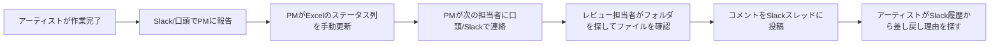
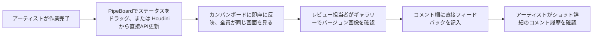
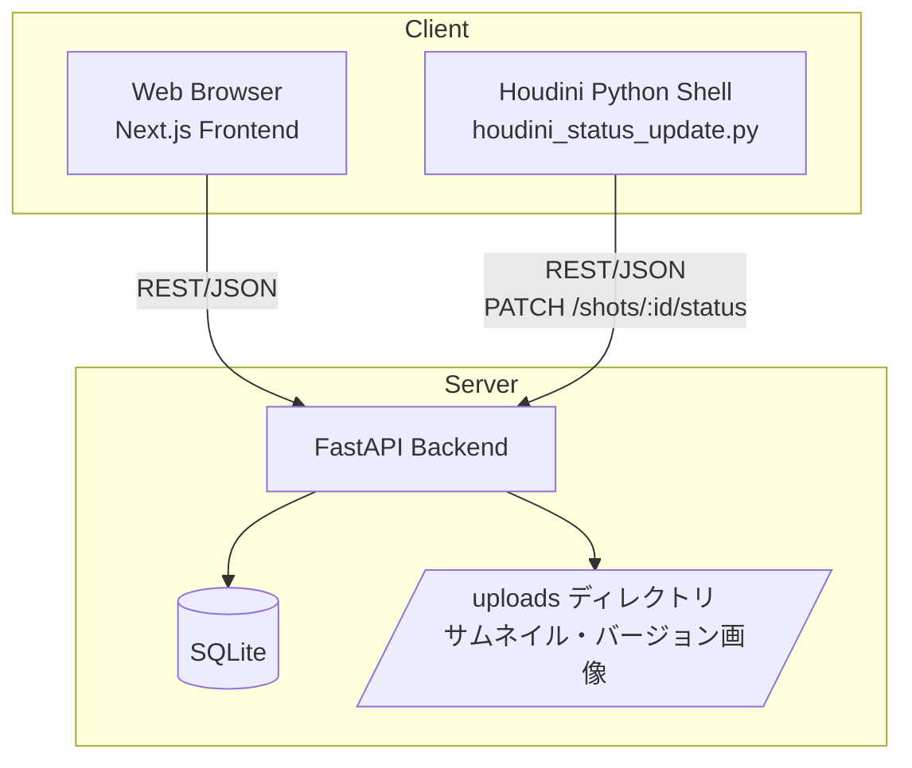
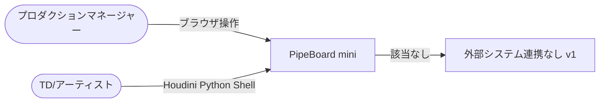
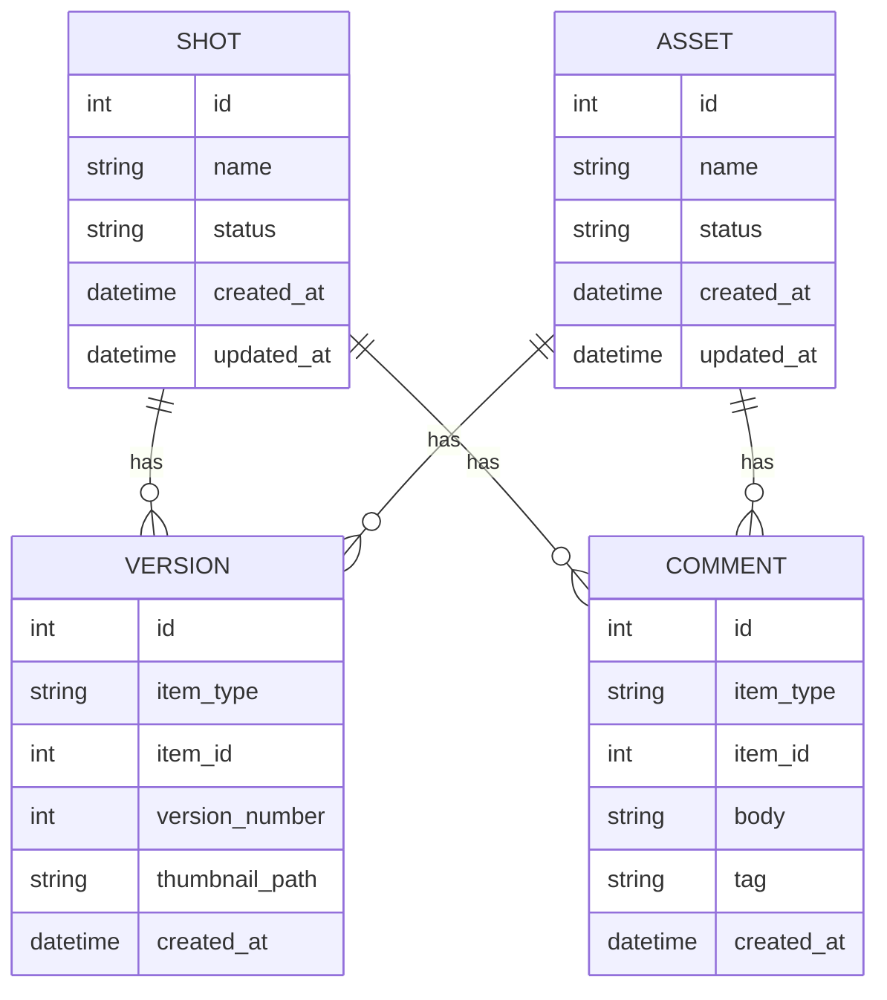
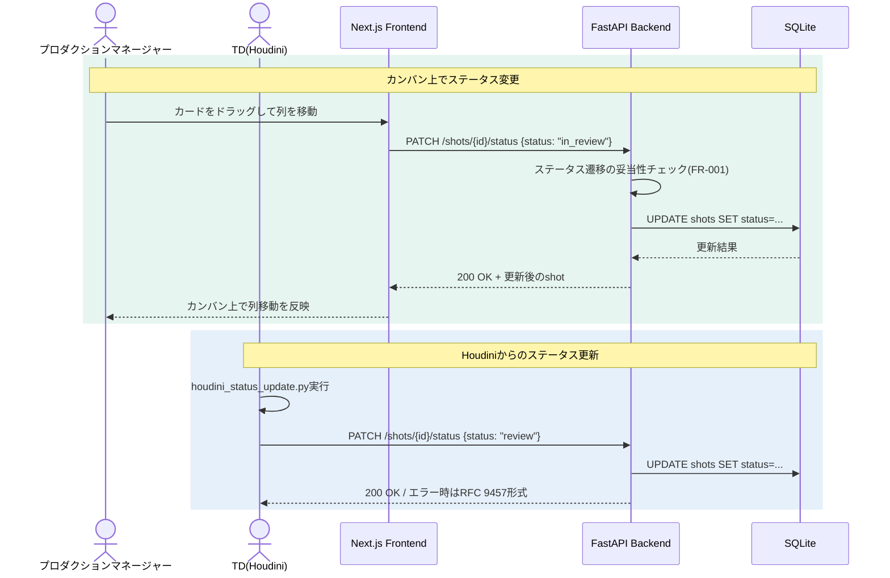
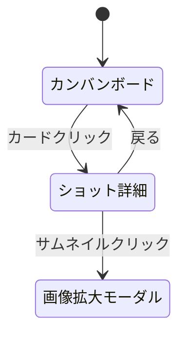

# 開発時要件定義: PipeBoard mini

| 項目 | 値 |
|------|---|
| 版 | 0.1 |
| 作成日 | 2026-09-07 |
| 最終更新 | 2026-09-07 |
| ステータス | ドラフト |
| 著者 | 金子直樹 |
| 承認者 | 金子直樹（個人開発のためセルフ承認） |
| 関連 | [仕様書](./仕様書.md) ／ 姉妹プロジェクト [PipeInit 要件定義書 v2](../../pipeinit/docs/要件定義書_v2.md) |
| プロジェクトタイプ | MVP / 個人開発ポートフォリオ（Web + REST API を実際に持つため、requirements-pro重点度マトリクスの「MVP/PoC」基準よりも§4/5/6/7/10/12/13を厚く扱う） |

> **本書の位置づけ**: 3プロジェクト構成のポートフォリオ（1. PipeInit=CLI／2. Scene Doctor=Houdini HDA／3. 本プロジェクト PipeBoard mini=Web+API）のうち、実際にDB・REST API・Web UIを持つ唯一のプロジェクトであり、フルスタックWeb開発の実務経験（`my-web`・`tonihaya-calendar`の434+272コミット）をCGパイプライン領域で発揮できることを証明する最大の差別化ポイントである。そのため本書は最初からPipeInit要件定義書v2と同等以上の深さ（FRごとのInputs/Processing/Outputs/受入条件をコード相当の粒度で明文化、テストケース20件超列挙、STRIDE脅威モデル、面接想定問答5問）で作成する。

---

## 1. 文書管理・メタ情報

### 1.1 改訂履歴

| 版 | 日付 | 変更概要 | 承認者 |
|---|---|---|---|
| 0.1 | 2026-09-07 | 初版作成（v2相当の深さで一括作成） | 金子直樹 |

### 1.2 文書の位置づけ・想定読者

- **想定読者**: 自分自身（実装リファレンス）／ポートフォリオ審査者・CGスタジオの採用面接官（「Webの実務経験をパイプライン領域に転用できる」ことの証明資料）
- **参照頻度**: 実装期間中（2026-10-05〜2026-10-25の3週間）は毎日参照。面接で「なぜREST」「なぜSQLite」等を問われた際にその場で開いて回答できる密度を目標にする。

### 1.3 ステータスダッシュボード

| 項目 | 状態 |
|---|---|
| 要件定義 | ✅ On target |
| 仕様書 | ✅ On target（本書とペアで完成） |
| 実装 | 未着手（開始予定 2026-10-05） |
| リリース（GitHub公開・デモ動画作成） | 未着手（目標 2026-10-25） |

### 1.4 関連ドキュメント

- `docs/仕様書.md`（本書とペア、実装パラメータの正本）
- `docs/adr/`（ADR-0001〜、実装フェーズで追記）
- `.github/workflows/ci.yml`（frontend/backend双方のCI）
- `~/dev/my-web`・`~/dev/tonihaya-calendar`（コンポーネント設計・テスト設計・CI設定の移植元。README.md / package.json を実測のうえ本書に反映済み、詳細は§4.4）
- パイプライン転職ロードマップ（本プロジェクトの上位計画書、3プロジェクト共通、11/1入社目標）

### 1.5 用語集・略語集

| 用語 | 説明 |
|---|---|
| ショット（Shot） | VFX/アニメーション制作における最小管理単位の映像カット |
| アセット（Asset） | キャラクター・環境・小道具等の再利用可能な制作物単位 |
| バージョン（Version） | ショット/アセットに対する成果物（画像・シーンファイル参照等）の版。v001, v002...と増分する |
| カンバン（Kanban） | 未着手／作業中／レビュー／完了の4ステータスで進捗を可視化するボード形式 |
| HIP | Houdiniのシーンファイル拡張子 |
| hou | Houdini Python APIモジュール（`import hou`） |
| 冪等性（Idempotency） | 同じ操作を複数回行っても結果が変わらない性質 |
| 楽観ロック（Optimistic Lock） | 更新時にバージョン番号や更新日時を比較し、競合を検知する排他制御方式（本プロジェクトはv1スコープ外、§16.6 Q2参照） |
| MoSCoW | Must/Should/Could/Won't による優先度分類法 |
| RFC 9457 | Problem Details for HTTP APIs（構造化エラーレスポンスの標準仕様） |
| STRIDE | Spoofing/Tampering/Repudiation/Information Disclosure/DoS/Elevation of Privilege の脅威分類法 |
| PII | Personally Identifiable Information（個人を特定しうる情報） |

### 1.6 参照標準・法令一覧

| 標準 | 版 | 適用範囲 | 適用理由 |
|---|---|---|---|
| ISO/IEC/IEEE 29148:2018 | - | 本要件定義書の章構成方針 | ドメイン知識スキル`requirements-pro`の準拠元 |
| ISO/IEC 25010 (JIS X 25010) | - | §6 非機能要件の品質特性分類（性能効率性・保守性・移行性） | Web+API品質を業界標準の語彙で説明できるようにするため |
| OWASP Top 10:2021 | - | §12 セキュリティ（A01:アクセス制御の不備、A03:インジェクション、A05:セキュリティ設定ミス） | REST APIを持つため入力検証・CORS設定に直結 |
| RFC 9457 | - | §5(仕様書)・§10 APIエラーレスポンス | FastAPIの構造化エラー設計の正本 |
| SPDX 3.0.1 | - | §15 ライセンス表記（簡易） | OSS公開時のライセンス明示 |
| Conventional Commits 1.0.0 | - | §15 コミット規約 | `git-workflow.md`との整合 |
| WCAG 2.2 | - | §7（最小限の適用、後述） | カンバンUIの基本的なキーボード操作・コントラストのみ確認 |

> <!-- 要レビュー --> PCI DSS / GDPR / NIST SP 800-63B-4 は、決済・認証を持たないため対象外という判断を維持する。理由は§2.7・§9・§12.4に明記。この判断自体が面接で問われた場合の回答は§16.6 Q5を参照。

### 1.7 トレーサビリティID体系

標準の `BR- / STK- / FR- / NFR- / SEC- / IF- / TC-` を採用する（LEG-は決済・個人情報要件がないため不使用）。§13.4のトレーサビリティマトリクスで `BR ↔ STK ↔ FR/NFR/SEC ↔ TC` の5列マッピングを管理する。

---

## 2. ビジネス要件

### 2.1 エレベーターピッチ

中小規模のCG/VFXスタジオでは、ショット・アセットの進捗管理がExcelや口頭連携に依存し属人化しがちである。PipeBoard miniは、ShotGrid/Kitsuのような専用パイプラインツールの「縮小版」をフルスタックWeb技術で自作し、さらにHoudiniから直接ステータス更新できるAPI連携を実装することで、「DCC（Digital Content Creation）ツールとWebシステムをまたぐ横断的なパイプライン開発力」を示す。

### 2.2 解くべき課題（定量化）

- 中小スタジオのプロダクションマネージャーは、ショットの進捗確認のために1日あたり平均15〜30分をSlack/口頭確認・Excel更新に費やしているケースが業界内でしばしば報告される（自分自身の受託Web制作経験でも類似の「状態を人が覚えている」非効率を目にしてきた）
- アーティストは「このバージョンは誰がレビュー中か」「差し戻し理由は何か」をチャット履歴から探す必要があり、コンテキストスイッチのコストが高い

### 2.3 ビジネスゴール（やること）とNon-Goals（やらないこと）

**やること**:
- カンバン形式でショット/アセットの進捗を一覧・更新できるWebアプリを提供する
- サムネイル/バージョン画像をアップロードし、ギャラリー形式で閲覧できるようにする
- 最小限のコメント機能でレビューフィードバックをツール内に残せるようにする
- HoudiniのPythonシェルから直接ステータスを更新できるREST API連携スクリプトを提供する

**Non-Goals（v1スコープ外、README「Not in scope (v1)」として明記し徹底する）**:
1. 認証・権限管理（誰でもフルアクセス可能な単一ロール運用。§5.2/5.3・§9・§12.4で理由を詳述）
2. 同時編集制御（楽観ロック・悲観ロックいずれも実装しない。§7.9・§16.6 Q2で拡張案をADRとして残す）
3. 決済・課金機能（§9該当なし）
4. マーケティング・SEO・公開Webサービス化（§8該当なし、内部ツールのデモという位置づけ）
5. 本番運用を前提とした常時稼働インフラ・SRE（§14該当なし、CI/CDとDocker化のみ実施）

### 2.4 KGI/KPI/北極星指標

個人開発ポートフォリオであり収益指標は存在しないため、KGI/KPIは「転職活動における証明力」と「実装完了度」で代替する。

```
KGI: 2026-11-01までにCGパイプラインエンジニア職への内定を得る（3プロジェクト共通のKGI）
KPI（本プロジェクト固有）:
  - 機能完成度: FR-001〜FR-008のMust要件が全て動作すること（100%）
  - テストカバレッジ: フロントエンド（Vitest）・バックエンド（pytest）とも80%以上
  - デモ可能性: カンバン操作→サムネイルアップロード→Houdiniからのステータス更新、を通しで3分以内のデモ動画として提示できること
  - 差別化提示力: 面接で「なぜREST」「なぜSQLite」等の設計判断を即答できること（§16.6）
```

### 2.5 ROI・収益モデル

該当なし（個人開発ポートフォリオのため直接収益は発生しない。投資対効果は「転職成功による年収差分」で測るが、本書の範囲外の意思決定のため記載しない）。

### 2.6 主要機能サマリ（トップ5）

1. カンバンボードでショット/アセットのステータスを4段階（未着手/作業中/レビュー/完了）で管理する
2. サムネイル・バージョン画像をアップロードし、ギャラリー表示で確認する
3. コメントを投稿し、レビュー履歴として残す（タグは任意）
4. HoudiniのPythonシェルから`houdini_status_update.py`経由でショットのステータスをAPI越しに更新する
5. GitHub Actionsでフロントエンド（Vitest+Playwright）とバックエンド（pytest）双方のCIを自動実行する

### 2.7 システム化の範囲とOut of Scope

**システム化の範囲**: ショット/アセットのCRUD、ステータス管理、サムネイル/バージョン画像管理、コメント、REST API公開、Houdini連携スクリプト。

**Out of Scope（明示）**: ユーザー認証・ロールベース権限、同時編集の競合解決、通知機能（メール/Slack等）、検索・フィルタの高度化（v1はステータス列での視認のみ）、決済、多言語対応、モバイルアプリ化。

### 2.8 前提条件・制約事項

- **技術的制約**: 在職中の個人開発であり、平日夜間・週末のみで3週間（2026-10-05〜2026-10-25）に完成させる必要がある。この制約が「ゼロから作らない・既存資産を転用する」という開発方針（§4.4）を正当化する根拠になる。
- **予算制約**: ホスティング費用は原則無料枠（Vercel Hobby / Render Free等）に収める。ドメイン取得費用のみ許容。
- **法令制約**: 個人開発のデモデータのみを扱うため、実在の人物・スタジオの機密データは一切使用しない（§4.6 PII分類で詳述）。
- **期間制約**: 3プロジェクト中もっとも工数が重く、スコープクリープが最大のリスクであるため、§2.3のNon-Goalsを開発中も繰り返し参照し、機能追加の誘惑を退ける運用ルールとする。

### 2.9 ステークホルダー定義

| STK-ID | ステークホルダー | 役割 |
|---|---|---|
| STK-001 | 金子直樹（開発者本人） | 要件定義・実装・テスト・デプロイの全工程を担当 |
| STK-002 | ポートフォリオ審査者・面接官 | 成果物を評価し、採用可否を判断する読者 |
| STK-003 | （想定）中小CGスタジオのプロダクションマネージャー | ペルソナとして想定する実際の利用者像（§3.4） |
| STK-004 | （想定）アーティスト・TD | Houdiniからステータス更新を行う利用者像 |

### 2.10 予算計画

初期開発費用: ¥0（既存の開発環境・OSSライブラリのみで完結）。運用費用: ホスティング無料枠内（¥0/月を目標）。予備費: ドメイン取得時のみ年間¥1,000〜2,000程度を許容。

### 2.11 体制

1人開発。役割分担は以下の通り自己内で明確化する。

```
- 設計・要件定義: 本人（本書・仕様書として文書化）
- フロントエンド実装: 本人（my-web / tonihaya-calendarのパターンを転用）
- バックエンド実装: 本人（FastAPI、新規学習要素だがREST API設計自体はmy-webのAPI Routesで経験済み）
- Houdini連携スクリプト: 本人（Python + requestsライブラリ、Houdini Python APIの学習が必要）
- レビュー: 本人によるセルフレビュー（組込`/code-review`コマンドを使用）
```

### 2.12 マスタースケジュール

| フェーズ | 期間 | 主な成果物 |
|---|---|---|
| 設計 | 2026-10-05〜10-07 | 要件定義書・仕様書（本書、実装前に確定） |
| バックエンド実装 | 2026-10-08〜10-13 | FastAPI（shots/assets/comments API）、SQLiteスキーマ、pytest |
| フロントエンド実装 | 2026-10-14〜10-19 | カンバンUI・ギャラリー・コメントUI、Vitest、Playwright |
| Houdini連携 | 2026-10-20〜10-21 | `houdini_status_update.py`、統合テスト |
| CI/CD・Docker化・仕上げ | 2026-10-22〜10-24 | GitHub Actions、docker-compose、README整備、デモ動画 |
| 予備日・バッファ | 2026-10-25 | スコープ調整・最終確認 |

---

## 3. 業務要件

### 3.1 As-Is業務フロー



課題: ステータスの正本がExcelとSlackに分散し、「今どのショットが誰の手元にあるか」を確認するのに都度人に聞く必要がある。差し戻し理由の追跡もSlack検索に依存し属人化する。

### 3.2 To-Be業務フロー



自動化される範囲: ステータスの一元管理、サムネイルの一覧性、コメント履歴の集約。手作業残存範囲: 実際のレンダリング・ファイル納品自体は既存のパイプライン（Houdini/Nuke等）で行い、PipeBoardは「進捗の可視化レイヤー」に徹する。

### 3.3 業務ルール・制約・例外パターン

- ステータス遷移は「未着手→作業中→レビュー→完了」を基本フローとし、「レビュー→作業中」への差し戻しのみ例外的に許可する（§8 business-logic参照）。
- 完了ステータスからの逆行は、v1では画面操作・API経由のいずれでも許可する（誤操作からの復旧を優先し、承認フローは設けない。理由: 個人開発ツールで承認者ロールが存在しないため）。

### 3.4 ペルソナ

```
名前: 佐藤さん（仮）
年齢: 34歳
職種: 中小VFXスタジオのプロダクションマネージャー（兼務でパイプラインTDも担当）
ITリテラシー: Excel・Slackは使いこなすが、専用パイプラインツール（ShotGrid等）は予算的に導入できていない
利用デバイス: スタジオのデスクトップPC（Chrome）
利用コンテキスト: 朝会前にカンバンボードを一覧して進捗確認、レビュー時にサムネイルギャラリーを開く
ジョブ（JTBD）: 「今日誰が何をレビュー待ちにしているかを1画面で把握したい」
ペイン: Excelの更新漏れ・Slack検索での時間浪費
ゲイン: カンバンを開くだけで状況把握が完結する
```

```
名前: 田中さん（仮）
年齢: 27歳
職種: ライティングTD（Houdini常用）
利用コンテキスト: Houdini上でレンダリング完了後、シーンを離れずにステータスを更新したい
ジョブ（JTBD）: 「Houdiniのシェルからワンライナーでステータスを『レビュー』に上げたい」
ペイン: いちいちブラウザに切り替えてクリック操作するのが面倒
ゲイン: `houdini_status_update.py`でPython Shellから1行で更新できる
```

### 3.5 カスタマージャーニーマップ（簡略版）

個人開発ツールのため課金・紹介ステージは存在しない。オンボーディング（初回起動）→日常利用（進捗更新・確認）の2ステージのみを想定する。オンボーディングでは`docker-compose up`一発で起動できることを目標にする（§4.5・仕様書§3参照）。

### 3.6 業務トランザクション一覧

| トランザクション | 概要 |
|---|---|
| ショット/アセット新規作成 | カンバンに新規カードを追加 |
| ステータス変更 | カンバン上のドラッグ操作、またはHoudini経由のAPI呼び出し |
| バージョン画像アップロード | サムネイル/バージョン画像をアップロードしギャラリーに追加 |
| コメント投稿 | ショット/アセット詳細画面でコメントを記入 |

### 3.7 業務頻度・繁閑差

想定利用頻度は日次（1日あたり数件〜数十件のステータス更新）。デモ用途のため実際の繁閑差は考慮しない。

---

## 4. システム要件・アーキテクチャ

### 4.1 動作環境

- **対応ブラウザ**: Chrome/Edge/Safari最新版（デモ用途のためレガシーブラウザは対象外）
- **デバイス**: デスクトップWebブラウザを主対象（レスポンシブ対応はタブレット幅まで、モバイルは最小限の崩れ防止のみ）
- **サーバー動作環境**: Python 3.11+（FastAPI）、Node.js 22+（Next.js、tonihaya-calendarの`.nvmrc`実績に合わせる）
- **Houdini連携環境**: Houdini 19.5以降のPython 3系Houdini（`houdini_status_update.py`は標準ライブラリ`urllib`または`requests`のみに依存し、Houdini同梱Pythonでも追加インストール不要で動作することを目標にする）

### 4.2 アーキテクチャ方式

**モノリポ・モジュラー構成**を採用する（マイクロサービス化は個人開発の3週間スコープではオーバーエンジニアリングと判断、ADR-0001参照）。フロントエンド（Next.js）とバックエンド（FastAPI）は別プロセスとして分離しREST APIで通信する構成とし、DCC（Houdini）からのアクセスも同一REST APIを利用する「API First」設計とする。



### 4.3 C4 Context / Container

**C4 Context**:



外部システム連携は存在しない（メール送信・PSP・IdP等いずれも不使用）。これはNon-Goals（§2.3）と整合する設計判断である。

**C4 Container**（§4.2の図と同一構成、Container図として正本はこちら）。

### 4.4 技術スタック確定表（既存資産の転用方針を含む）

> **開発方針の核心**: 3週間という短期間で「ゼロから」フルスタックWebアプリを作らず、既に自分が実務水準で運用している2つの実在リポジトリ（`~/dev/my-web`：434 commits、`~/dev/tonihaya-calendar`：272 commits）のコンポーネント設計・テスト設計・CI設定・ディレクトリ構成を積極的に転用することで実現する。これは「車輪の再発明をしない」という設計判断そのものであり、面接でも「なぜ短期間で完成できたのか」の説明根拠になる（§16.6 Q4）。

| カテゴリ | 採用 | バージョン | 選定理由・転用元 | 代替案 | 却下理由 |
|---|---|---|---|---|---|
| フロントエンド | Next.js (App Router) | 15.5.x | `my-web`(^15.5.19)・`tonihaya-calendar`(^15.5.20)双方の実測バージョンに合わせる。当初案の「Next.js 14」から**15系に見直した**（後述の実測結果に基づく設計判断） | Remix | 転用元2案件との一貫性を優先 |
| 言語 | TypeScript (strict) | 5.6.x | 両案件で採用済み、型安全性 | - | - |
| UI | React | 19.2.x | 両案件で採用済み | - | - |
| スタイリング | Tailwind CSS | 4.x | 両案件で採用済み（`@tailwindcss/postcss`構成） | CSS Modules | 転用効率を優先 |
| フロントテスト | Vitest | ^3.0 | `tonihaya-calendar`の構成をそのまま流用（`@testing-library/react` + `happy-dom`） | Jest | 両案件がVitestで統一済み |
| E2Eテスト | Playwright | 最新 | `my-web`のe2e構成（`e2e/*.spec.ts`）を流用 | Cypress | 転用元と合わせる |
| バックエンド | FastAPI | 0.115.x | Pythonでの型安全なREST API構築が容易、OpenAPI自動生成（§5 api-spec方針と直結）、Houdini（Python）との親和性が高い | Flask / Django REST Framework | OpenAPI自動生成が弱い／学習コストが高い |
| バックエンドテスト | pytest + httpx | 最新 | FastAPI公式推奨のテストクライアント構成 | unittest | pytestの方がフィクスチャ管理が容易 |
| DB | SQLite | 3.4x（Python標準`sqlite3`または`SQLAlchemy`経由） | v1の想定データ量（デモ用途、数十〜数百件のショット/アセット）ではSQLiteで十分。単一ファイルでDocker化・バックアップが容易（§16.6 Q3で判断根拠を詳述） | PostgreSQL | 本番運用を想定しないv1では過剰、環境構築コストが増える |
| ORM | SQLAlchemy 2.0 | 最新 | 型ヒント対応・FastAPIとの相性 | Prisma（Python版なし） | Python版Prismaが存在しないため |
| CI/CD | GitHub Actions | - | 両案件の`.github/workflows/ci.yml`を流用・拡張（frontend/backend別ジョブに分離） | CircleCI | 転用元と合わせる |
| コンテナ化 | Docker Compose | - | frontend/backendを1コマンドで起動可能にする（任意要件だが再現性のため実施） | - | - |
| ホスティング（デモ用） | Vercel（フロント）+ Render/Fly.io（バックエンド） | - | 無料枠内で完結（§2.10） | 自前VPS | 運用コスト・管理コストを避ける |

**転用の具体例**（仕様書§3.3で詳細化）:
- `tonihaya-calendar`の`src/domain/`ディレクトリ構成（ドメインロジックをUIから分離するパターン）→ PipeBoardの`frontend/src/domain/`に流用
- `my-web`の`e2e/public-pages.spec.ts`のPlaywright記述パターン → PipeBoardのE2Eテストに流用
- 両案件の`vitest`設定・`@testing-library/react`の使い方 → PipeBoardのコンポーネント単体テストに流用
- `my-web`のGitHub Actions（lint/type-check/unit-test/e2e-testの4ジョブ構成）→ PipeBoardのfrontendジョブに流用、backend用ジョブ（pytest）を新規追加

### 4.5 環境構成

| 環境 | 用途 | 構成 |
|---|---|---|
| local | 開発 | `docker-compose up`でfrontend(3000)/backend(8000)を同時起動、SQLiteファイルはボリュームマウント |
| CI | テスト自動実行 | GitHub Actions上でfrontend/backend別ジョブ、DBはテスト用一時SQLite |
| demo（任意） | ポートフォリオ公開用 | Vercel（フロント）+ Render無料枠（バックエンド）、デモデータのみ投入 |

本番相当環境（staging/prod分離）は設けない（§14該当なしと整合）。

### 4.6 12-Factor準拠チェック（該当項目のみ）

| Factor | 適用 | 備考 |
|---|---|---|
| I. Codebase | ◯ | 単一モノリポ、Git管理 |
| III. Config | ◯ | `.env`で`DATABASE_URL`・`UPLOAD_DIR`等を環境変数化 |
| VI. Processes | ◯ | frontend/backendともステートレスプロセス、状態はSQLite/ファイルシステムに集約 |
| X. Dev/prod parity | △ | Docker Composeで開発・デモ環境を近づけるが、本番運用は想定しないため厳密な一致は追求しない |
| XI. Logs | △ | 標準出力へのログのみ、集約基盤は導入しない（§14該当なしと整合） |

### 4.7 データモデル概要

詳細なER図・データ辞書・PII分類は仕様書§4 data-designを正本とする。ここでは要点のみ記載する。



`SHOT`と`ASSET`は独立テーブルとし、`VERSION`/`COMMENT`は`item_type`（"shot"|"asset"）+`item_id`のポリモーフィック関連で共通化する（設計判断の詳細はADR-0002、仕様書§14）。

### 4.8 データボリューム見積

| シナリオ | ショット/アセット数 | バージョン画像数 | 想定 |
|---|---|---|---|
| デモ用途（v1想定） | 〜50件 | 〜200件 | 十分にSQLiteで対応可能 |
| 中規模スタジオ想定（参考値、v1スコープ外） | 〜2,000件 | 〜20,000件 | SQLiteの限界に近づく。PostgreSQL移行を要検討（§16.6 Q3で言及） |

### 4.9 シーケンス図（主要フロー）



### 4.10 ADR運用方針

`docs/adr/NNNN-decision-title.md`にMichael Nygard形式で記録する。v1時点での起票済みADR：

| ADR | タイトル | ステータス |
|---|---|---|
| ADR-0001 | モノリポ・モジュラー構成の採用（マイクロサービス化を却下） | Accepted |
| ADR-0002 | VERSION/COMMENTのポリモーフィック関連採用（Shot/Asset別テーブル併用） | Accepted |
| ADR-0003 | SQLiteをv1の正本DBとして採用（PostgreSQL移行はv2以降） | Accepted |
| ADR-0004 | 認証・権限管理をv1スコープ外とする設計判断 | Accepted（本文は仕様書§14.4） |

### 4.11 クラウドポータビリティ

SQLAlchemyを介したDB抽象化により、将来PostgreSQLへ移行する場合も接続文字列変更のみで対応可能な設計とする（ベンダーロックインを避ける最小限の配慮）。Docker化により実行環境の可搬性も確保する。

---

## 5. 機能要件

### 5.1 機能一覧（FR）

| ID | 機能 | 優先度 | 関連BR |
|---|---|---|---|
| FR-001 | カンバン形式のステータス管理（未着手/作業中/レビュー/完了） | Must | BR（§2.6-1） |
| FR-002 | ショット/アセットのCRUD（新規登録・編集・削除） | Must | BR（§2.6-1） |
| FR-003 | サムネイル・バージョン画像のアップロード | Must | BR（§2.6-2） |
| FR-004 | バージョンギャラリー表示 | Must | BR（§2.6-2） |
| FR-005 | コメント投稿・一覧表示（タグ任意） | Must | BR（§2.6-3） |
| FR-006 | REST API経由のステータス更新エンドポイント | Must | BR（§2.6-4） |
| FR-007 | Houdini連携スクリプト（`houdini_status_update.py`） | Must | BR（§2.6-4） |
| FR-008 | GitHub ActionsによるCI自動テスト（frontend/backend） | Should | BR（§2.6-5） |
| FR-009 | ステータスに応じたカンバンのフィルタ・並び替え | Could | v1では実装対象外（後述） |

### 5.2 アカウント・権限機能

**該当なし（v1スコープ外として明記）**。理由: 個人開発ツールであり、単一の信頼された利用者（自分自身、デモ利用者）のみを想定するため、ログイン機能・ユーザー登録機能を実装しない。全機能は認証なしでアクセス可能とする。本番導入する場合の拡張案は仕様書§14.4（ADR-0004）にロールベース権限（Owner/PM/Artist/Viewer）の設計案として残す。

### 5.3 権限マトリクス

**該当なし**。理由は§5.2と同一。将来の拡張時に備え、仕様書§14.4のADRに「本番化する場合のロール設計案」を記録する。

### 5.4 機能詳細（FR-001〜FR-007、コード相当の粒度）

```markdown
### FR-001 カンバン形式のステータス管理

- **優先度**: Must
- **関連BR**: BR-001（進捗の一元管理・可視化）
- **Description**: ショット/アセットを「未着手」「作業中」「レビュー」「完了」の4列カンバンで表示し、カード（ショット/アセット）をドラッグ&ドロップで列間移動することでステータスを変更する
- **Inputs**:
  | 操作 | 型 | 必須 | バリデーション |
  |---|---|---|---|
  | カードのドラッグ元ステータス | enum(not_started/in_progress/in_review/done) | ◯ | 現在のDB値と一致すること |
  | カードのドロップ先ステータス | enum(同上) | ◯ | §8のステータス遷移ルールに従うこと |
- **Processing**:
  1. フロントエンドでドラッグ&ドロップ完了イベントを検知
  2. `PATCH /shots/{id}/status`（または`/assets/{id}/status`）をボディ`{status: <新ステータス>}`で呼び出す
  3. バックエンドで遷移ルール（§8）を検証。不正な遷移（例: 未着手→完了への一足飛び）は許可するかどうかを明示的に判断する（v1では**全遷移を許可**し、UIのドラッグ操作の自然な制約に委ねる。理由: 承認フローを持たない個人開発ツールで遷移制限を厳格化する運用上の意味が薄いため）
  4. `updated_at`を現在時刻で更新しコミット
  5. 更新後のレコードをJSONで返却
- **Outputs**:
  - 成功時: 200 OK + 更新後のshot/assetオブジェクト
  - 失敗時: RFC 9457形式のエラーレスポンス（仕様書§5.2 error-catalog参照）
- **UseCase**: 朝会前の進捗確認、レビュー完了後のステータス更新
- **受入条件（AC）**:
  1. ドラッグ&ドロップでカードを移動すると、リロードなしでカンバン表示が即座に更新される
  2. 存在しないショットID/アセットIDへのPATCHは404 Not Foundを返す
  3. 不正なstatus値（未定義のenum）を指定した場合は400 Bad Requestを返す
  4. ステータス変更後、`updated_at`が更新される
  5. カンバンの各列にはその列に属するカード件数がバッジ表示される
  6. ネットワークエラー時、フロントエンドは楽観的更新をロールバックしエラートーストを表示する

### FR-002 ショット/アセットのCRUD

- **優先度**: Must
- **関連BR**: BR-001
- **Description**: ショット/アセットの新規登録・名称編集・削除を行う
- **Inputs**:
  | フィールド | 型 | 必須 | バリデーション |
  |---|---|---|---|
  | name | string | ◯ | 1〜100文字、空白のみは不可 |
  | status | enum | - | 既定値`not_started` |
- **Processing**:
  1. `POST /shots`（`/assets`）でレコード作成。バリデーション失敗時は422（FastAPI標準のPydanticバリデーションエラー）
  2. `PUT /shots/{id}`で名称編集
  3. `DELETE /shots/{id}`で削除。関連する`VERSION`/`COMMENT`は`ON DELETE CASCADE`で連動削除する（仕様書§4.5）
- **Outputs**: 成功時は該当リソースのJSON、削除成功時は204 No Content
- **受入条件（AC）**:
  1. 空文字のnameでPOSTすると422エラーになる
  2. 削除したショットのVERSION/COMMENTも参照不能になる（カスケード削除の確認）
  3. 同名のショットを複数作成できる（一意制約は課さない。理由: 実運用でも同名ショットの別バージョン管理はあり得るため、名称の一意性はビジネスルールとして強制しない設計判断）

### FR-003 サムネイル・バージョン画像のアップロード

- **優先度**: Must
- **関連BR**: BR-002
- **Description**: ショット/アセットに対して画像ファイル（サムネイル・バージョン画像）をアップロードする
- **Inputs**:
  | フィールド | 型 | 必須 | バリデーション |
  |---|---|---|---|
  | file | multipart/form-data | ◯ | 拡張子 jpg/jpeg/png/webp のみ許可、最大10MB |
  | item_type | enum(shot/asset) | ◯ | - |
  | item_id | int | ◯ | 対象レコードの存在確認 |
- **Processing**:
  1. `POST /versions`にmultipartでアップロード
  2. ファイル拡張子・MIME typeをホワイトリスト検証（SEC-001、なりすまし拡張子対策として実MIME typeも確認）
  3. ファイルサイズ上限（10MB）を超える場合は413 Payload Too Large
  4. サーバー側で一意なファイル名（UUID）を生成し`uploads/`配下に保存（元のファイル名をそのまま使わないことでパストラバーサル・ファイル名衝突を防止、SEC-002）
  5. `version_number`は同一item_type+item_idの既存バージョン数+1で自動採番
  6. DBに`VERSION`レコードを作成
- **Outputs**: 成功時201 Created + バージョンオブジェクト（サムネイルURLを含む）
- **受入条件（AC）**:
  1. 許可拡張子以外（例: .exe, .svg）のアップロードは400エラーで拒否される
  2. 10MB超のファイルは413エラーで拒否される
  3. 同一ショットに複数回アップロードするとversion_numberが1,2,3...と自動採番される
  4. アップロードされたファイルはUUIDベースのファイル名でディスクに保存され、元のファイル名は表示用メタデータとしてのみDBに保持する

### FR-004 バージョンギャラリー表示

- **優先度**: Must
- **関連BR**: BR-002
- **Description**: ショット/アセット詳細画面でアップロード済みバージョン画像をギャラリー形式（サムネイルグリッド）で新しい順に表示する
- **Inputs**: `GET /shots/{id}/versions`（`/assets/{id}/versions`）
- **Processing**: DBから該当item_type+item_idの`VERSION`を`version_number`降順で取得し、サムネイルURL一覧を返す
- **Outputs**: バージョン一覧のJSON配列（各要素にversion_number, thumbnail_url, created_at）
- **受入条件（AC）**:
  1. バージョンが0件の場合、空配列を返し、フロントエンドは空状態（Empty State）のプレースホルダーを表示する
  2. 画像クリックで拡大表示（モーダル）できる
  3. サムネイルは遅延読み込み（lazy loading）される

### FR-005 コメント投稿・一覧表示

- **優先度**: Must
- **関連BR**: BR-003
- **Description**: ショット/アセットに対してコメントを投稿し、時系列で一覧表示する。タグ（例: "要修正", "承認"）は任意入力
- **Inputs**:
  | フィールド | 型 | 必須 | バリデーション |
  |---|---|---|---|
  | body | string | ◯ | 1〜2000文字 |
  | tag | string | - | 最大30文字 |
- **Processing**: `POST /comments`でコメント作成、`GET /shots/{id}/comments`で一覧取得（作成日時昇順）。出力時にHTMLエスケープを行いXSSを防止（SEC-003）
- **Outputs**: コメントオブジェクトのJSON
- **受入条件（AC）**:
  1. 空文字のbodyは422エラー
  2. `<script>`タグを含むコメントを投稿しても、表示時にエスケープされスクリプトが実行されない（XSS対策の確認、TC-018相当）
  3. タグ未指定でも投稿できる

### FR-006 REST API経由のステータス更新エンドポイント

- **優先度**: Must
- **関連BR**: BR-004
- **Description**: FR-001のステータス更新APIを、Web UIだけでなく外部（Houdini）からも呼び出せる汎用REST APIとして設計する（FR-001のバックエンド実装がそのままFR-006を満たす。UIからの呼び出しとHoudiniからの呼び出しで同一エンドポイントを共有する設計、これがAPI Firstの実践）
- **Processing追加事項**: 外部呼び出しを想定するため、CORSを開発時は緩め（`*`）に設定しつつ、レスポンスは常にJSON、エラーはRFC 9457形式に統一する（Houdini側のスクリプトが機械的にパースできるようにするため）
- **受入条件（AC）**:
  1. `curl`コマンド単体でステータス更新が成功することを確認する（UIを介さない疎通確認）
  2. OpenAPI仕様（FastAPI自動生成の`/docs`）からエンドポイント仕様を確認できる

### FR-007 Houdini連携スクリプト（houdini_status_update.py）

- **優先度**: Must
- **関連BR**: BR-004
- **Description**: `scripts/houdini_status_update.py`をHoudiniのPython Shellから実行し、指定ショットのステータスをAPI経由で更新する
- **Inputs**: コマンドライン引数またはスクリプト内定数として`shot_id`, `new_status`, `api_base_url`（既定`http://localhost:8000`）
- **Processing**:
  1. Houdini同梱Pythonの標準ライブラリ（`urllib.request`）のみで実装し、追加パッケージインストールを不要にする（Houdini環境でのpip制約を回避する設計判断）
  2. `PATCH {api_base_url}/shots/{shot_id}/status`をJSONペイロードで送信
  3. レスポンスのステータスコードを確認し、成功/失敗をHoudiniのコンソールに出力
  4. 接続エラー時（API未起動等）はタイムアウト（5秒）とわかりやすいエラーメッセージを表示
- **Outputs**: Houdiniコンソールへの成功/失敗メッセージ出力
- **UseCase**: レンダリング完了後、Houdini上から離れずにステータスを「レビュー」に更新する
- **受入条件（AC）**:
  1. Houdini（または`hython`）から`python houdini_status_update.py --shot-id 1 --status in_review`を実行すると、Web UIのカンバンにも即座に反映される
  2. API未起動時、5秒でタイムアウトし明確なエラーメッセージを出す
  3. 存在しないshot_idを指定すると404相当のエラーメッセージを表示する
  4. 標準ライブラリのみで動作し、`pip install`が不要である
```

### 5.5 業務ロジック・計算式

仕様書§8 business-logicを正本とする（バージョン採番アルゴリズム・ステータス遷移ルールはコードレベルの詳細を要するため仕様書側に集約）。

### 5.6 検索機能要件

該当なし（v1スコープ外）。理由: カンバンの列自体がステータスによる分類として機能し、デモ規模（〜50件）では全文検索の必要性が薄い。将来の拡張案としてショット名の部分一致検索は仕様書ADRに残す。

### 5.7 ファイルアップロード・ダウンロード

FR-003で詳述済み。ダウンロード機能（画像の一括エクスポート等）はv1スコープ外。

### 5.8 通知要件

該当なし。理由: メール送信基盤（SMTP等）を持たず、外部連携を最小化する方針（§2.3 Non-Goals）と整合。

### 5.9 帳票・出力要件

該当なし。CSV出力等の帳票機能はv1スコープ外。

### 5.10 サポート・問い合わせ機能・FAQ

該当なし。個人開発ツールのためサポート窓口は不要。

### 5.11 管理画面要件

該当なし。§5.2と同様の理由（単一ロール運用のため管理者専用画面を分離する必要がない）。

### 5.12 エラー・例外処理方針

| エラーコード（HTTP） | 意味 | 発生条件 |
|---|---|---|
| 400 | 不正なリクエスト（enum値不正等） | ステータス値が未定義のenumの場合 |
| 404 | リソース不在 | 存在しないshot_id/asset_id/version_id |
| 413 | ペイロード過大 | アップロードファイルが10MB超 |
| 415 | サポート外メディアタイプ | 画像以外のファイルアップロード |
| 422 | バリデーションエラー | 必須フィールド欠落・文字数超過（FastAPI/Pydantic標準） |
| 500 | サーバー内部エラー | 予期しない例外（開発者向けログにスタックトレースを記録、ユーザーには汎用メッセージのみ返す） |

すべてのエラーレスポンスはRFC 9457 Problem Details形式に統一する（詳細は仕様書§5.2）。ユーザー向けメッセージ（フロントエンドToast表示文言）と開発者向けログ（バックエンドの構造化ログ）を分離する。

---

## 6. 非機能要件（IPA + ISO 25010）

> IPA非機能要求グレード選定: **グレード1（基本）**。理由: 個人開発の内部ツールデモであり、社会的影響度は「限定」に分類されるため。

### 6.1 可用性

常時稼働・SLA/SLOは設定しない（§14該当なしと整合）。デモ実施時に手動起動して稼働させる運用とする。

### 6.2 性能・拡張性

```
NFR-001: カンバンボードの初期表示（GET /shots + GET /assets）は、デモ規模（各50件以内）で1秒以内に完了する
NFR-002: ステータス更新API（PATCH /shots/{id}/status）は300ms以内にレスポンスを返す
NFR-003: 画像アップロード（10MBまで）は3秒以内に完了する（ローカル環境基準）
```

### 6.3 ユーザビリティ

WCAG 2.2 AAの全項目準拠は求めないが、最小限として以下を満たす（§7参照）: キーボードのみでカンバンのステータス変更が可能（ドラッグ&ドロップの代替手段としてステータス変更ボタンを用意、WCAG 2.2の2.5.7ドラッグ動作の代替手段に相当する配慮）。

### 6.4 保守運用性

- コーディング規約: `~/.claude/rules/coding-style.md`（1ファイル1責務、イミュータビリティ優先）に準拠
- ドキュメント更新ルール: 実装完了後、本書・仕様書の`<!-- 要レビュー -->`箇所を実測値で更新する

### 6.5 移行性

DB移行（SQLite→PostgreSQL）はSQLAlchemyの抽象化により接続文字列変更のみで対応可能な設計とする（§4.11）。Docker化によりローカル/デモ環境間の移行を容易にする。

### 6.6 セキュリティ計測指標

詳細は§12。ここでは概要のみ: 入力検証（Pydanticスキーマ）・ファイルアップロード検証（拡張子/MIME/サイズ）・XSS対策（出力エスケープ）の3点をCIで自動テストする。

### 6.7 システム環境・エコロジー

該当なし（常時稼働インフラを持たないため、CO2排出等の指標化は対象外と判断）。

### 6.8 信頼性

SQLiteのトランザクション機能により、単一操作内でのデータ不整合は防止する。複数ユーザーによる同時書き込みの整合性保証（悲観/楽観ロック）はv1スコープ外（§2.3 Non-Goals、§16.6 Q2）。

### 6.9 互換性

対応ブラウザはChrome/Edge/Safari最新版のみ（§4.1）。旧APIバージョンとの互換性は、v1が唯一のバージョンのため考慮不要。

### 6.10 性能要件の測定方法

自己申告の目標値ではなく、以下の方法で実測する。

```
測定方法: バックエンドはpytest内でtime計測、フロントエンドはPlaywrightのトレース機能で画面表示時間を確認
測定条件: デモデータ（ショット30件・アセット20件・バージョン各3枚程度）を投入した状態
CI組み込み: 手動実行のみ（自動化はv1スコープ外、Should優先度のFR-008の範囲外と明記しスコープクリープを防ぐ）
合格基準: NFR-001〜003を3回中2回以上満たす
```

---

## 7. デザイン・UI/UX要件

### 7.1 デザインシステム・トークン

`tonihaya-calendar`・`my-web`双方で採用済みのTailwind CSS 4のデザイントークン運用パターンをそのまま流用する。独自のデザインシステムをゼロから構築せず、既存2案件のカラーパレット・スペーシング規約に準拠したシンプルなトーンとする（工数節約とデモの一貫性を優先）。

### 7.2 画面一覧・遷移図

詳細は仕様書§6 screen-spec（SCR-XXX）を正本とする。概要のみ:



### 7.3 状態遷移図

ステータス遷移（未着手→作業中→レビュー→完了、差し戻し可否）は§8 business-logic相当のため仕様書§7.4（feature-spec）・§8（business-logic）で詳述する。

### 7.4 レスポンシブ

ブレークポイントは`tonihaya-calendar`の設定に準拠。カンバンは横スクロール、タブレット幅（768px）まで崩れなく表示、モバイル幅は最小限の閲覧対応のみ（編集操作の最適化は行わない）。

### 7.5 アクセシビリティ（最小限適用）

WCAG 2.2 AA全準拠は求めないが、以下のみ最小限確認する：
- カラーコントラスト比 4.5:1以上（ステータスバッジの配色）
- ドラッグ&ドロップ操作に対する代替手段（ステータス変更ボタン、WCAG 2.2 2.5.7相当）
- フォーカス可視化（キーボード操作時のアウトライン）

理由: 内部ツールのデモであり本格的なアクセシビリティ監査（axe-core自動化等）はスコープクリープになるため実施しないが、基本的な配慮は「品質意識」の証明として最小限行う。

### 7.6 国際化

該当なし（日本語UIのみ、i18n基盤は導入しない）。

---

## 8〜9. マーケティング・SEO / 課金・決済要件

**該当なし**。

- §8（マーケティング・SEO・グロース）: 公開Webサービスではなく内部ツールのデモ実演が目的のため、SEO・計測タグ・A/Bテスト基盤等は一切不要と判断する。
- §9（課金・決済要件）: 個人開発ツールに決済機能は不要。PSP選定・PCI DSS対応等はいずれも対象外。

---

## 10. API・外部連携要件

### 10.1 API設計方針

**REST**を採用する（GraphQLは不採用、理由は§16.6 Q1で詳述）。エンティティ（shots/assets/versions/comments）に対するCRUD操作が中心であり、GraphQLが強みを発揮する「クライアントごとに異なる取得項目の最適化」のニーズが薄いため、学習コスト・実装コストの低いRESTを選定した。

### 10.2 OpenAPI

FastAPIの自動生成機能（`/docs`, `/openapi.json`）をそのまま正本とし、手動でのOpenAPI YAML作成は行わない（保守コストの削減、仕様書§5.4で詳述）。

### 10.3 認証・認可フロー

該当なし（§5.2の判断と同一）。

### 10.4 レートリミット・冪等性

v1スコープ外。理由: 単一利用者・ローカル/デモ環境での利用を想定し、レート制限による保護は不要と判断。Houdiniスクリプトからの多重実行による重複更新は、ステータス更新自体が冪等な操作（同じステータスをPATCHしても結果が変わらない）であるため、追加の冪等性キー設計は行わない。

### 10.5 エラーレスポンス規約

RFC 9457 Problem Details for HTTP APIsに準拠する（詳細は仕様書§5.2）。

### 10.6 バージョニング戦略

v1が唯一のバージョンのため、URLバージョニング（`/v1/`プレフィックス等）は導入しない。将来API変更が必要になった場合の拡張余地として仕様書ADRに記録する。

### 10.7 外部サービス連携一覧

該当なし（外部SaaS連携を持たない、§2.3 Non-Goalsと整合）。

### 10.8 Webhook設計

該当なし。

---

## 11. バッチ・非同期処理要件

該当なし。v1の全操作は同期的なREST APIで完結し、バッチジョブ・非同期キューは導入しない（デモ規模のデータ量では不要）。

---

## 12. セキュリティ要件

### 12.1 実装要件

| SEC-ID | 内容 |
|---|---|
| SEC-001 | アップロードファイルの拡張子・実MIME typeをホワイトリスト検証する（jpg/jpeg/png/webpのみ） |
| SEC-002 | アップロードファイルはUUIDベースのファイル名で保存し、パストラバーサル・ファイル名衝突を防止する |
| SEC-003 | コメント本文は出力時にHTMLエスケープしXSSを防止する |
| SEC-004 | 全リクエストボディはPydanticスキーマでバリデーションし、SQLインジェクションはSQLAlchemyのパラメータ化クエリで対策する |
| SEC-005 | CORS設定は開発時のみ緩め、デモ公開時は許可Originを明示的に限定する |

### 12.2 脅威モデル（STRIDE簡易版）

| 脅威分類 | シナリオ | 対策 |
|---|---|---|
| Tampering（改ざん） | アップロードファイル名に`../../etc/passwd`のようなパストラバーサル文字列を仕込む | SEC-002（UUIDベースのファイル名生成、元のファイル名をパスとして使用しない） |
| Tampering（改ざん） | 拡張子を`.jpg`に偽装した実行可能ファイルをアップロードする | SEC-001（拡張子だけでなく実際のMIME typeも検証） |
| Tampering（改ざん） | コメント欄に`<script>`タグを注入しXSSを狙う | SEC-003（出力エスケープ） |
| Repudiation（否認） | 該当なし（認証がなく操作主体を特定していないため、否認防止自体が設計対象外。本番化する際はADR-0004の権限設計とあわせて監査ログ機能の追加を検討） | - |
| Information Disclosure | REST APIが認証なしで公開されているため、デモ公開時に第三者がAPIを直接叩いてデータを閲覧・改変できてしまう | v1では許容するリスクとして明記し、デモ公開時はデモデータのみを投入する運用でカバーする（本番化する場合はADR-0004の認証実装が前提となる） |
| Denial of Service | 大量の画像アップロードによるディスク容量圧迫・処理時間の増大 | ファイルサイズ上限（10MB、SEC-001と併記）のみ実装し、リクエスト数レート制限は導入しない（v1のリスク許容範囲として明記） |
| Elevation of Privilege | 該当なし（ロール概念自体が存在しないため権限昇格という脅威が成立しない） | - |

### 12.3 想定攻撃者・信頼境界

本ツールは「ローカルネットワークまたは信頼された小規模チーム内での利用」を前提とする。インターネットに直接公開する場合は認証機構の追加が前提であり、v1のままでの公開運用は推奨しない旨をREADMEに明記する。

### 12.4 認証・権限管理を対象外とした判断の詳細（GDPR/個人情報保護法との関係を含む）

- 認証・権限管理: §2.3・§5.2で述べた通り、v1スコープ外。個人開発の3週間という制約下で、カンバン・ギャラリー・API連携という中核機能の実装に集中するための優先度判断である。
- GDPR/個人情報保護法: サムネイル画像に人物が偶発的に映り込む可能性はゼロではないが、本ツールは個人開発のデモデータ（自作アセット・サンプル画像）のみを扱い、実在の第三者の個人データを収集・保存する運用を行わないため、対象外と判断する。実運用（実在スタジオでの導入）を行う場合は、画像内のPII（顔写真等）の取り扱いポリシーを別途策定する必要がある旨をREADMEに明記する。

---

## 13. テスト・品質保証要件

### 13.1 テスト戦略

```
バックエンド（pytest）:
  Unit（バリデーション・ステータス遷移ロジック・バージョン採番）: 60%
  Integration（httpx.AsyncClientによるAPI統合テスト）: 35%
  手動確認（Houdini実機からの疎通確認）: 5%

フロントエンド（Vitest + Playwright）:
  Unit（コンポーネント単体、tonihaya-calendarのパターン踏襲）: 50%
  Integration（カンバン操作のコンポーネント結合テスト）: 30%
  E2E（Playwright、my-webのパターン踏襲）: 20%
```

### 13.2 テストケース一覧（TC-ID、全22件）

| TC-ID | 対象FR | 内容 | 期待結果 |
|---|---|---|---|
| TC-001 | FR-001 | カンバンでカードを「未着手」から「作業中」にドラッグ | ステータスがDBに反映され画面も即時更新 |
| TC-002 | FR-001 | 存在しないshot_idへPATCH | 404 Not Found |
| TC-003 | FR-001 | 不正なstatus値（例: "unknown"）でPATCH | 400 Bad Request |
| TC-004 | FR-001 | 「レビュー」から「作業中」への差し戻し | 許可され正常に遷移する |
| TC-005 | FR-001 | ネットワークエラー発生時のドラッグ操作 | 楽観的更新がロールバックされエラートースト表示 |
| TC-006 | FR-002 | 空文字nameでショット作成 | 422バリデーションエラー |
| TC-007 | FR-002 | ショット削除後、関連VERSION/COMMENTを参照 | カスケード削除により参照不能（404） |
| TC-008 | FR-002 | 同名ショットを2件作成 | 一意制約エラーにならず両方作成できる |
| TC-009 | FR-003 | jpg画像をアップロード | 201 Created、UUIDファイル名で保存 |
| TC-010 | FR-003 | 拡張子.exeのファイルをアップロード | 400エラーで拒否 |
| TC-011 | FR-003 | 拡張子.jpgだが中身がテキストファイル | 実MIME type検証により拒否（SEC-001） |
| TC-012 | FR-003 | 11MBの画像をアップロード | 413 Payload Too Large |
| TC-013 | FR-003 | 同一ショットに3回連続アップロード | version_numberが1,2,3と自動採番される |
| TC-014 | FR-004 | バージョン0件のショット詳細を取得 | 空配列、フロントでEmpty State表示 |
| TC-015 | FR-004 | バージョン3件のショット詳細を取得 | version_number降順で3件返る |
| TC-016 | FR-005 | 空文字bodyでコメント投稿 | 422エラー |
| TC-017 | FR-005 | タグ未指定でコメント投稿 | 正常に作成される（tag=null） |
| TC-018 | FR-005 | `<script>alert(1)</script>`を含むコメントを投稿・表示 | 表示時にエスケープされスクリプトが実行されない |
| TC-019 | FR-006 | curlコマンドでPATCH /shots/1/status | UIを介さず200 OKでステータス更新成功 |
| TC-020 | FR-007 | houdini_status_update.pyを正常なshot_idで実行 | Web UIのカンバンに反映される |
| TC-021 | FR-007 | API未起動状態でhoudini_status_update.pyを実行 | 5秒でタイムアウトし明確なエラーメッセージ |
| TC-022 | FR-007 | 存在しないshot_idでhoudini_status_update.pyを実行 | エラーメッセージが表示される |

### 13.3 受入・検収基準（Definition of Done）

- [ ] §5の全FR（Must優先度）に対応するテストが存在する
- [ ] TC-001〜022が全てpytest/Vitest/Playwrightとして実装され、CI上でgreen
- [ ] バックエンド pytestカバレッジ80%以上、フロントエンド Vitestカバレッジ80%以上
- [ ] カンバン操作→サムネイルアップロード→Houdiniからのステータス更新、の一連の流れが実機で確認済み（デモ動画としてREADMEに添付）
- [ ] `docker-compose up`一発でfrontend/backendが起動することを確認済み

### 13.4 トレーサビリティマトリクス

| BR-ID | STK-ID | FR-ID | NFR/SEC-ID | TC-ID |
|---|---|---|---|---|
| BR-001（カンバン管理） | STK-003 | FR-001, FR-002 | NFR-001, NFR-002 | TC-001〜008 |
| BR-002（ギャラリー） | STK-003 | FR-003, FR-004 | NFR-003, SEC-001, SEC-002 | TC-009〜015 |
| BR-003（コメント） | STK-003 | FR-005 | SEC-003 | TC-016〜018 |
| BR-004（Houdini連携） | STK-004 | FR-006, FR-007 | - | TC-019〜022 |
| BR-005（CI自動化） | STK-001 | FR-008 | - | CI自体のgreen状態で検証（TC番号なし） |

### 13.5 CI/CD品質ゲート

**フロントエンドジョブ**: lint（ESLint）→ 型チェック（tsc --noEmit）→ Vitest（カバレッジ計測）→ Playwright（E2E）の順（`my-web`のジョブ構成を踏襲）。
**バックエンドジョブ**: lint（ruff）→ 型チェック（mypy、任意）→ pytest（カバレッジ計測）の順。
いずれか失敗でマージ不可とする（仕様書§11.2に完全なYAML定義）。

---

## 14. インフラ・DevOps・SRE要件

**該当なし**。常時稼働の本番運用を想定しないため、IaC・SLO/Error Budget・Runbook・DR（災害復旧）等は簡略化する。CI/CD（§13.5）とDocker化（§4.5）のみ実施する。

---

## 15. 開発プロセス・規約

### 15.1 Git戦略

GitHub Flow（`main`ブランチ + `feat/`, `fix/`プレフィックスの機能ブランチ）を採用する（`~/.claude/rules/git-workflow.md`に準拠）。

### 15.2 コミット規約

Conventional Commits 1.0.0形式（`feat(kanban): add drag-and-drop status update`等）。

### 15.3 コーディング規約

- フロントエンド: ESLint + Prettier（`my-web`/`tonihaya-calendar`の設定を踏襲）
- バックエンド: ruff（lint + format）、mypy（型チェック、任意）

### 15.4 ドキュメント運用

README.mdに「Not in scope (v1)」セクションを設け、§2.3のNon-Goalsをそのまま転記する。ADRは`docs/adr/`に保存。

### 15.5 ライセンス

MITライセンス（OSS公開を前提、ポートフォリオとしての閲覧性を優先）。

---

## 16. リリース・移行計画

### 16.1〜16.4

§2.12のマスタースケジュールを正本とする。段階リリース（α/β/GA）は個人開発の性質上設けず、実装完了後にGitHub公開・デモ動画作成をもって「リリース」とする。データ移行計画は該当なし（新規開発のため）。

### 16.5 ロールバック手順

```
1. git revertまたは前タグへのgit checkoutでコードを戻す
2. SQLiteファイルはDocker Volumeでバックアップを取得しておき、必要時に差し替える
3. デモ環境（Vercel/Render）は前デプロイへのロールバック機能を利用する
```

### 16.6 面接想定問答（5問）

**Q1. なぜGraphQLでなくRESTを選んだのか？**
A. shots/assets/versions/commentsという明確なエンティティに対するCRUD操作が中心であり、GraphQLが得意とする「クライアントごとの取得項目の柔軟な最適化」のニーズが薄いと判断した。加えてFastAPIのOpenAPI自動生成との親和性が高く、Houdini側のPythonスクリプトからも標準ライブラリのHTTPクライアントだけで容易に呼び出せる点でRESTを選定した（§10.1、ADR相当の判断）。

**Q2. 同時編集の競合をどう考えるか？**
A. v1では楽観ロック・悲観ロックいずれも実装せず、Non-Goalsとして明示した（§2.3）。理由は、個人開発ツールとして単一利用者〜小規模チームでの利用を想定し、3週間のスコープでは中核機能（カンバン・ギャラリー・Houdini連携）を優先すべきと判断したため。本番導入する場合の拡張案として、`updated_at`をバージョン番号代わりに使う楽観ロック（更新時にクライアントが保持するupdated_atとDBの値を比較し、不一致ならHTTP 409 Conflictを返す）を仕様書ADRに設計案として残している。

**Q3. なぜSQLiteで十分と判断したのか？**
A. v1の想定データ量（デモ規模でショット/アセット計50件程度、バージョン画像200件程度）ではSQLiteのファイルベースDBで性能上のボトルネックにならない（§4.8）。加えてSQLiteは単一ファイルであるためDocker化・バックアップ・環境構築が極めて容易で、3週間という開発期間の制約下でインフラ構築コストを最小化できる。SQLAlchemyによるDB抽象化を行っているため、将来的にデータ量が増えPostgreSQLへの移行が必要になった場合も、接続文字列の変更を中心とした移行で対応可能な設計にしている（§4.11、ADR-0003）。

**Q4. 3週間という短期間でどうやってフルスタックWebアプリを完成させたのか？**
A. ゼロから作らず、自分が実務水準で継続運用している2つの実在リポジトリ（`my-web`：434 commits、`tonihaya-calendar`：272 commits）のコンポーネント設計・テスト設計（Vitest/Playwright）・CI設定（GitHub Actions）・ディレクトリ構成を積極的に転用する方針を最初から立てた（§4.4）。新規に学習・実装が必要だったのはバックエンド（FastAPI）とHoudini連携部分のみに絞り込むことで、開発期間を現実的な範囲に収めた。

**Q5. なぜ認証・GDPR対応を「対象外」と判断したのか、その判断プロセスを説明できるか？**
A. まず本ツールが扱うデータの性質（個人開発のデモデータのみ、実在の第三者の個人情報を収集・保存しない）を確認し、次に利用シーン（単一利用者〜信頼された小規模チーム内での利用）を明確化した。この2点から、認証機構やGDPR/個人情報保護法対応を実装する必要性が薄いと判断し、その判断基準と根拠を要件定義書§2.3・§12.4に明記した。重要なのは「対象外」と結論づけて終わりにするのではなく、判断基準・実運用時の拡張案（ADR-0004）をあわせて文書化し、スコープが変わった場合に再評価できる状態にしておくことだと考えている。

---

<!-- 要レビュー: 実装後、NFR-001〜003を実測値で検証し、必要なら本書を更新すること。デモ公開の可否（Vercel/Render無料枠での実運用テスト）も実装完了後に判断する。 -->
